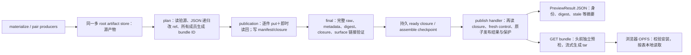

# Preview publication：减少复制与读回的可选方案

2026-11-13；分析基线 `1ed28d1aacf98742d21f758018996453ef8128f4`，目标 worktree HEAD `b985a6496587e36014a7eea5349b3d807c562844`，二者 `vnext/`、`frontend/`、`deploy/` 无差异。本稿仅设计，未改产品/配置、运行新测试/测量、删除校验或部署。测量候选 `4cfe47f399fdaa2a40df3ef875940359ee304f71` 只作诊断来源，未合回。前次[热点设计](preview-hotspots-and-business-parallelism-design.md)和[独审](/home/dev/gdds-stage-exchange/gw08-preview-design-sol/DESIGN-REVIEW.md)仍是历史判断；本稿提出的新取舍需要另审，不冒称已被前审批准。

**结论：可以减少写后读回，也可以避免大量 bundle 专属副本；这两项都不要求把 Preview 改成易失内存。** 最小方案把逐件即时读回合并到已有 final 完整验证；更有潜力的方案是让逻辑 bundle 直接引用已有不可变产物，仅持久化真正改变的成员与 manifest/closure。完全内存直返技术上可做，但改变刷新、重启恢复、下载与 Submit 的现有业务语义，当前没有这项授权。

## 1. 证据能支持什么

已读[初始基线](/home/dev/gdds-stage-exchange/gw08-preview-baseline-sol/REPORT.md)、[首轮](/home/dev/gdds-stage-exchange/gw08-preview-bundle-measurement-sol/REPORT.md)、[第二轮](/home/dev/gdds-stage-exchange/gw08-preview-bundle-measurement-sol/round2/REPORT.md)，并核对第二轮 `analysis.json`、`mo/containers.log` 的父段/读验聚合及结果身份说明。未读取远端业务数据或重新解析 SQL。

| 第二轮普通 t4 MO，05，空 INITIAL，N1/M24 | 秒 |
| --- | ---: |
| 受理至同 operation 结果可读 | 140.206917 |
| bundle | 40.534650 |
| 其中 plan / publication＋即时读回 / final | 7.110655 / **28.462917** / 2.547620 |
| 三父段之外 | 2.413459 |

publication 占 bundle 70.22%，但没有拆 put、同步、existing 命中与即时读回；**28.46 秒不是可省时间，也不是纯磁盘写入时间**。plan/final 两处的第二次 locate＋helper hash 合计 2.177256 秒，helper hash 仅 0.016907 秒，不能借这些数字替 publication 读回定价。各轮单次、不同时刻、未控 page cache，差值不能证明提速或回退。表统计仍截断/partial，不能用于完整产物盘点；05 的绑定扩展诊断结果不等于 08 实际延迟。

## 2. 当前实际流程与产物

源码：[Preview 调用](../../vnext/backend/src/gateway_backend/application/preview_jobs.py#L2090) → [kernel wrapper](../../vnext/backend/src/gateway_backend/application/kernel_execution.py#L167) → [assembler](../../vnext/backend/src/gateway_backend/capabilities/bundle_assembly/_assembly.py#L93)。wrapper 没有传 destination，assembler 的 `target_store = source_store`；这指同一个多 root store，**不保证相同物理 root**。源件可在 comparison/canonical/durable，最终 `_bundle_artifact_id` 属 export。

| publication 对象 | 当前源码事实 | 已有 exact ref 与新写的界限 |
| --- | --- | --- |
| Parquet 等 binary | plan 不改 bytes，但 `_build_final_ref` 无条件按 bytes/type 生成 export bundle ID | 源 ref 已存在不表示目标 ref 已存在；即使 bytes 相同也会复制到新身份。目标 ID 若已由先前 bundle/同内容产物写入，才是 exact-existing 候选 |
| JSON 无嵌套 ref，或递归 rewrite 后 bytes 相等 | 仍生成 bundle ID | 同样可能只换身份而复制；不能把所有 JSON 都叫真正新内容 |
| JSON 嵌套 ref 实际改变 | 递归 rewrite、JCS，生成对应新 raw/ref | 属真正改变的成员；不能复用旧 bytes 充当新 ref。变更可沿父 JSON 传递 |
| 各 pair surface | 重写 surface refs，重算 digest/JCS，再生成 export ref | 当引用改变时是新内容；即使内容相同也走 put。surface 不是早已保存的完整 tar |
| bundle manifest / 原 artifact closure | 完整成员及语义绑定形成后生成，分别 put | 两个新发布元数据对象；同内容同 ID 时也可能 existing |

`_deduplicate_generated` 在 publication 前合并重复 final refs，shared/table_bindings 语义仍需保留。现有证据没有逐项 source==final、目标 exact-existing、changed JSON 的数量/字节/耗时；fresh 应用根不能替代这些计数。binary 源/目标的 bytes 相同是源码事实，目标命中比例不是事实。

## 3. 各次写与验分别保护什么

| 边界 | 当前职责与具体实现 | 可以怎样缩减 |
| --- | --- | --- |
| Local put 输入与落盘 | [put_chunks](../../vnext/backend/src/gateway_backend/infrastructure/artifact_store/local_store.py#L126)：ref/limit/root；capacity；staging 按输入核 size/SHA；payload/ref 文件 fsync，staging/祖先目录同步，no-replace rename，发布目录同步 | 保存当前 durable READY 语义时，新内容仍要持久化；不以“Preview 可重算”默默删掉所有同步。同步策略若另改，应作为 derived 状态的耐久性取舍单独审，不外推到 control DB、Dolt commit 或 main CAS |
| put exact-existing 分支 | **先完整 stage/fsync，再 rename 冲突**，才 `_verify_existing`：stored ref 必须相同且完整读 size/SHA；不同/损坏不覆盖 | 可将“安全目标解析＋existing 完整验证”提前；确认已存在有效对象后跳 stage/capacity-copy。输入 bytes/ref 自身仍核对；only missing 才 stage，竞态 winner 仍在 no-replace 冲突分支核对。保留保证已有目录发布耐久所需的最少同步（上次写可能在rename后、目录fsync前退出），不凭可读直接断言已durable。不能仅 get_ref/exists 就信任 payload，也不能把损坏当 missing 盖写 |
| 逐件即时 `_verify_store_bytes` | put 后又 hash 内存、locate 目标并逐字节比较；manifest/closure 也做 | **可合并到后面的 final 完整读验**。当前 Contract 要求 READY 前回读，并未指定每次 put 之后都必须立即再读；这是检测时点/实现选择。失败会晚至 final 才暴露，可能多写一些未引用 derived 件，但仍不得 READY |
| final `validate_bundle` | 读 manifest/closure，canonical/版本/语义、所有 entry raw、digest/闭合、surface 链接；每 entry 还有 locate＋helper 第二次 locate | 最小方案保留其现有完整行为，作为 publication 后回读。若以后合并同点双读，另明确其第二时点变更检测取舍；不是依赖“put 成功”便取消语义校验 |
| ready/checkpoint 与 publish | [load_ready_closure](../../vnext/backend/src/gateway_backend/application/checkpoints.py#L471) 重新验证 durable refs；[publish handler](../../vnext/backend/src/gateway_backend/application/preview_jobs.py#L927) 有两次调用。事务内重查 workspace/generation/Head/lease，绑定结果并迁移保护 | 同 handler 已验证 closure/refs 可讨论短 scope 复用，保 fresh cancel/drift/CAS，恢复仍重读；不把本次 bundle 内存结论跨 step 搬过去。publish 6.602 秒是另一窗口，不在 28.46 秒内 |
| 后续下载 | [prepare_bundle_download](../../vnext/backend/src/gateway_backend/application/bundle_download.py#L64) 头前核完整 metadata/成员，持 root read session，流中再 bounded read/hash；HTTP 绑定 expected bundle digest | 是独立请求/消费者，负责缺失/损坏、错误结果绑定、路径安全与中途 I/O；不能由 worker 几分钟前 put 成功代替。当前不写持久 tar |

依据：[ArtifactStore port](../../vnext/backend/src/gateway_backend/artifacts/store.py#L17)、[P4 artifact/READY/CAS](refactoring/formal/plans/p4-durable-operation-runtime-design.md#L76)、[Bundle closure](contracts/comparison-bundle.md#artifact-closure)、[P7-S1a 混合位置补充](contracts/comparison-bundle.md#p7-s1a-目标补充混合位置交付待实现)。put 的返回契约是“持久化并返回 exact ref”；新写成功时 Local 校验的是写入的输入流，不等于独立从目标文件重新读取。没有必要为复用结论创建持久 receipt/evidence 状态机。

Preview 产物属于可恢复 derived 数据；但 operation/checkpoint/保护及 immutable PreviewResult 的发布属于 durable workflow，且绑定后续 Submit。它们不等同于审批、archive BaselineHead 或 Dolt commit/main 的权威事实。按[比例化政策](refactoring/formal/policies/proportional-assurance-and-risk-based-verification-policy.md)，可以修改 Preview 的旧设计选择，不能用 C 类 derived 状态理由跳过关联 A/B 类事务、授权、scope 和资源界限。

## 4. 少量方案比较

| 方案 | 真正取消的操作 | 保留 / API 与业务代价 | 判断 |
| --- | --- | --- | --- |
| A：合并即时读回到 final | generated、manifest、closure 各次 put 紧随的 `_verify_store_bytes`；不动 final | 持久 bytes/ref、最终完整回读与语义闭包、ready/publish/下载不变；无需 HTTP/DTO 或 digest 改版。应同步修订旧设计“所有 target 即时读保留”的实施限制及相关测试，不把它当永久 Contract | **最小可实施候选**；收益待 publication 内部计时，可能仅小部分 |
| B：existing fast path | exact-existing put 的 staging及新payload/ref副本与其同步；已有发布所需目录同步仍保留 | 完整输入/existing 核对、no-replace 竞态分支和最终验证不变；流式put也须消费/核完输入而非跳过generator。短 root session 可用现有协作 SH，不能跨恢复缓存 verified 状态；不改 wire/digest | 取决于 actual target 命中率；首次全新 bundle 的源已存在不能证明会命中 |
| C：逻辑 bundle 引用已有不可变成员 | bytes/ref 未变的 binary、无变化 JSON 的重新 ID、put 与副本；只写真正新内容和元数据 | source→final map 对复用项为 identity；依赖 ref 不变时父 JSON也可不改。所有最终 refs 必须写进 ready/protection 并原子移交，原 source/canonical 恢复 refs仍保留；下载仍按 logical_path 发完整 tar | **更值得后续研究的结构性方案**；不是把整个 bundle 只剩两个文件，surface/必要 rewrite JSON 仍可能新写 |
| D：持久引用＋直接流式响应 | 若仍保当前 tar下载，则编码层已经如此；worker内存直送最多省后端再读/传递 | worker与backend分进程，POST目前202异步 operation，结果另GET；直推内存需有界跨进程交接、背压/断连与恢复设计，或仍从持久refs读。加即时响应不是删除publication的自然捷径 | 先用 C，保现有HTTP；不先建新内存分发通道 |
| E：完全临时内存 Preview | 不落 derived 成员/closure，直接返回或临时流 | worker/API重启后丢失；下载重连/刷新无服务器副本；必须失效重算或在Submit时物化/重验，并重新绑定用户确认的结果。需改HTTP、operation/READY/checkpoint、Submit与保留语义，按M限制存活/并发/慢客户端 | 可行但属于产品取舍；当前不推荐且未获实施授权 |

C 已有 Contract 基础：P7-S1a **生效补充**明确“未改变身份且直接引用的成员保持原 ref/location；bundle-relative logical_path 是交付路径”，下载已支持多 root；当前 `_build_final_ref` 仍无条件重建全部成员，属于可以改变的实现选择。旧正文仍写 cache hit 必须复制并换 bundle ref，实施前须由 owner 明确统一：允许将合法 opaque artifact 以当前 bundle 的 closure/保护正式移交，而不是暴露 cache-local/host/repository path。若决定即便合法 opaque cache 成员也必须物理独立，C 只复用获准类别，不能绕过此决定。

C 不要求给前端增加表HTTP：前端用 closure 按 artifact_id 找 logical_path，不凭 EXPORT 前缀取文件；tar仍自包含。必须维持跨 pair shared/table_bindings 和唯一物理成员规则，不能把跨 Repository 同 hash 当授权。opaque ID/raw可能传递改变JSON、surface和bundle digest，按目标形态更新golden，不能承诺所有digest不变或保留双路径。跨 store 的独立 destination 仍须实际复制/验证，不能把 source 可读当 target可读。

若要**连 final 目标回读也取消**，需要把 Bundle“写入并完成回读后 READY”改成“输入流 size/SHA＋store durable exact put成功，内存 semantic/closure 校验后 READY”；异常存储由后续下载/恢复/Submit 的独立校验发现并重算/报错。好处是再省一遍目标读取；代价是 SUCCEEDED 与首次成功可下载之间不再由 READY 时点读验确认。此选择对 derived Preview 有讨论空间，并非安全上永远禁止，但收益未测且当前用户尚未接受这个行为变化。权威 commit/readback、事务/CAS不随之取消。

## 5. “内存打包给前端”对实际消费者的影响

当前 [PreviewResultResponse](../../vnext/backend/src/gateway_backend/http/schemas/preview.py#L76) 是身份/digest/stale 摘要，**不含全部表数据**。前端 [ComparisonPage](../../frontend/src/pages/ComparisonPage.tsx#L412) 读取摘要，GET bundle，再由 [ensureLocalBundle](../../frontend/src/features/bundle/local-bundle.ts#L251) 校验 tar并安装 OPFS；[表/records/risk](../../frontend/src/features/bundle/presentation.ts#L167) 从本地 Parquet/JSON读取。表格分页/过滤不是服务器逐页查询。取消服务器冗余副本与保留前端本地包是兼容的；改成逐表JSON API则改变现有离线浏览架构，不能与C混为一谈。

| 场景 | 现有 durable Preview / C | 完全内存 E 必须选择的行为 |
| --- | --- | --- |
| 网络断连、刷新、另一浏览器/OPFS被清 | 重新授权后按结果ID/digest再次下载；已有完整OPFS可复用 | 只靠当前浏览器缓存不能保证；临时服务内存仍在则重发，否则重新Preview |
| worker重启/接管 | 从持久checkpoint/refs验证恢复；完成结果可继续读 | 失去bytes；若保source但无derived，需重算，旧SUCCEEDED结果必须失效或显式“需重建” |
| 取消、drift、lease lost | 完整结果只在成功CAS后可见；未引用derived候选按原TTL处理 | 不能先向客户端发“可提交完成包”再检查CAS；必须定义部分流丢弃及稳定完成标识 |
| TTL / cleanup | current-preview、active attempt protected；superseded且无active consumer才按政策清理 | 必须有内存容量/存活期限及淘汰错误；不能把current-preview保护误当无限内存保留许可 |
| M与慢客户端 | worker bundle staging已有M预约，HTTP bounded流不持整包；OPFS存浏览器 | 若worker留包等下载，跨operation/慢客户端占M并妨碍新任务；转backend又超其2GiB envelope风险。须有界/背压/释放，不能借worker32GiB宣称backend能留全包 |

Submit 并不是接收浏览器回传完整可信结果：[accept](../../vnext/backend/src/gateway_backend/application/submission/accept.py#L85) 读持久 PreviewResult、冻结输入/Head/digest，接受事务转移 artifact保护；[prepare_import](../../vnext/backend/src/gateway_backend/application/submit_jobs.py#L1597) 再加载 `preview_ready_closure_ref` 并解析 canonical表/manifest。源上传包也须保留。C可保这些绑定；E需重设计“Submit如何物化并证明与用户所见结果相同”，不能只留下浏览器可修改JSON。

后续审批有 Submission/Workspace/Preview ID绑定（[review](../../vnext/backend/src/gateway_backend/application/submission/review.py#L106)）；Archive基于成功Submission的repository commit/configuration facts与审批/基线事务（[archive](../../vnext/backend/src/gateway_backend/application/archive/start.py#L211)），History重新从选定commits物化并比较（[history](../../vnext/backend/src/gateway_backend/application/history/compare_jobs.py#L401)）。**它们不要求永久保留每个Preview副本**，也不以浏览器内存为权威；删除冗余成员无需改它们的权威事实。不能据此跳过当前Submit前的持久closure依赖，也不能宣称审批/History只消费这一个下载tar。

## 6. 其他阶段能省的工作与跨阶段复用

以下顶层窗口取第二轮普通MO：materialize **36.532秒**、assemble **96.233秒**、publish **6.602秒**。三者互斥；下表hook/子段包含在对应顶层内，risk/export/bundle等hook还可能嵌套，**不求和，也不把父窗口当可省上限**。这是机会排序，不是全链路profile执行清单。

| 阶段与具体可减工作 | 已有成本证据及未知 | 保留语义 / 复用代价 | 优先级与最小核对 |
| --- | --- | --- | --- |
| materialize：canonical lookup/inspect、IPC编码、put | 顶层36.532；materialize hook31.352、parse0.889均在内且不是互斥细分。canonical0/312命中；编码/put/lookup未拆，不能说31秒全是持久化 | 同次stage已保留Arrow reader；当前[CanonicalTableStore](../../vnext/backend/src/gateway_backend/capabilities/snapshot_materialization/canonical_store.py)与[publish_canonical_tables](../../vnext/backend/src/gateway_backend/capabilities/snapshot_materialization/artifact.py#L491)已有reuse，不能重复计收益。可研究合法existing跳stage、同scope重复descriptor/metadata复用，仍核rules/schema/row metadata/raw身份；不把PROVISIONAL重标COMMIT_VALIDATED | P2；只有转向此段后才拆lookup/encode/put，沿用既有table-access/cache Contract向量与M边界 |
| checkpoint写：重复refs验证、state/envelope JSON编码；assemble恢复：同ref多次open/inspect/JCS | 写尾部在materialize顶层，恢复在assemble顶层；现有hook不覆盖全部，没有独立秒数。源码有refs验证/恢复路径，未证主导 | 可在同次prepare函数按完整ref去重、复用一次decode/已验证immutable backing；游标、lease版本、prior outputs、canonical/configuration身份仍由同一decoder/validator判断。持久checkpoint与保护事务保留；不因刚算好便把它改为跨step活对象 | P2条件性；先静态确认实际重复路径；仅若必要选写或恢复一处测，恢复与Submit canonical绑定测试复用 |
| pair：comparison records编码/落盘、risk提取/规则/annotation/report产物，重复identity assessment | compare2.789、risk22.070为assemble内累计hook；risk不是单纯规则CPU。records与risk put份额未知，不能由comparison小就认定records/risk小 | 同scope同inputs/rules的assessment可传不可变值给pair，不再次业务计算；records/report可复用exact内容及已验证metadata，但保table布局、ordered语义、risk全pair编号/annotation限额和确定性排序。[Comparison Contract](contracts/comparison.md)已明确新records不增加整份写后回读，不能假设这里已有可删整读 | P2；先选risk产物或records一个有证据的边界，不加通用业务表池；复用comparison/risk固定向量，只加实际变化边界 |
| export/cache：同operation重复lookup与命中bytes/schema/行数/layout验证、必要导出/排序/put | export16.039在assemble内；snapshot_export163/312命中，命中非零成本。表统计截断，实际重复ref/导出次数未知 | [client_parquet](../../vnext/backend/src/gateway_backend/capabilities/snapshot_materialization/client_parquet.py#L45)命中仍读验；pair已有prevalidated exports映射。可延伸同call/明确连续operation scope完整key结果复用，保持repository、writer、layout、side/table_bindings；有些相同表名不是相同数据。正常详细pair不因closure组装就必然再次完整导出；cache坏件仍按原miss/重建策略 | P2；先核现有映射是否覆盖目标调用点，再量真正重复的lookup/verify。C可顺带消除bundle再复制，不能又算一次export编码收益 |
| bundle：所有成员重ID/put、existing先stage、即时读回、同点双locate/JCS | publication28.463是已测最大父段；plan7.111、final2.548互斥包含在bundle40.535内。即时读回、new/existing和sync未知 | A/B/C见前文；保完整closure、必要落盘/最终读验与保护，按选中方案变更目标digest，不引入兼容双路径 | **P1**；唯一推荐下一组内部计时见§7，不自动展开其余行 |
| publish：两次ready closure解码＋全refs读取、checkpoint/state读取 | 顶层6.602；两次`load_ready_closure`源码确认，未逐次计时，不能把6.6秒都归重复读取或CAS | 可传已解码document/refs至同handler atomic helper，保fresh cancel/drift与事务CAS。若消除第二遍全refs验证，明确连续保护窗口及同trust-domain改变检测取舍，恢复/重试必须重新验证。pin只阻清理，不证明bytes永不损坏 | P3，若改及本handler才核相应成功/取消/漂移/恢复；不为纯decode复用动CAS/DB schema |
| 前端可见：后端结果可读→metadata GET→完整tar预检/传输→OPFS校验→表懒解析/渲染 | 140.207秒只测匹配PreviewResult可读，不含浏览器、tar下载/安装。上传0.261与受理0.037也不是表格可见时间。没有此尾段耗时 | 当前tar按需流式，无持久包可取消；可避免重复下载/本地重复解析但已有OPFS digest复用。按表后端分页或先显示摘要再补成员会改变完整包安装/可浏览语义；需独立选中，不能承诺C必令首次页面同比提速 | P2（若用户症状是“可读后仍等很久”）；先用已有前端旅程证据确认边界，未来最多一条代表浏览器计时，不扩全矩阵 |

同operation复用的最小原则是**同一业务算法、不同输入获取方式**：纯业务函数继续只消费相同冻结descriptor/ref/rules与规范数据；持久恢复loader负责把它们恢复出来。同一同步调用内已验证对象可减少重复获取/解码，仍用原M资源owner并按原序释放。真正跨step复用需额外证明前一步与当前claim之间没有lease/control/scope变更、保护连续、worker仍在及对象仍受M计费；当前架构即使正常successor也从durable checkpoint恢复，不能用“属于同operation”替代这些条件。

因此先利用现有stage/pair局部reuse，不建立跨step活reader/整包registry、序列化Python对象图、持久verified receipt或第二套“快算法”。若未来确选successor快路径，持久checkpoint仍是唯一恢复游标，快路径最多是可丢弃的输入获取提示；命中/未命中最终调用相同decoder/业务校验/计算与发布函数，失去提示只增加读取工作，不能改变摘要/错误分类/取消/CAS行为。若必须删掉正常successor某项恢复校验才能见收益，应直接修订该校验的Contract与适用时点，不用隐藏“快路径”规避；不为本轮先实现这套机制。

优先级P1表示已有互斥父段证据；P2表示有大窗口或明确consumer、内部归因未完成；P3表示候选较小或只确认重复调用。各项复用收益会重叠（如C减少export产物副本、同时降低ready refs规模/读量），不能逐行加出预计端到端改善。

## 7. 推荐下一步与最小验证

推荐保留 durable Preview 与当前前端交付；第一项实现候选选 A，先复用已有 final 完整回读来取消即时重复读回，避免先引入新调度池、批量发布API或内存服务。若目标是明显缩短28秒窗口，C优先于业务表并行进入下一项设计；B仅在exact-existing实测命中值得时实施。不是把A/B/C一次全部叠加。

若继续诊断，仅需**一份普通t4 MO、原05/N1/M24条件**，publication父段内记录互斥 `generated put / immediate readback / metadata put / metadata readback`；put再按target新建/合法existing计calls、bytes、elapsed，并区分source==final、仅换ID、JSON bytes改变。只在同步占主导且确有后续决策需要时细分stage/sync，不预建全链路观测。复用现成planned/source信息，不再读业务表或重解析SQL来做计数。该测量仅设计，本轮不执行；不能拿别的调用点locate秒数扣出“纯写耗时”。如先批准A实现，也可在一次受控前后对照中收这些计数，不把追加测量本身设为长期门禁。

获准实施后的验证按改动面收敛：

- A：复用 bundle正常/嵌套closure、损坏/错误store、destination失败、semantic tamper、取消与M不足测试；证明错误put返回或目标坏bytes仍不能READY。不新增每个fsync步骤的故障矩阵。digest/wire不变；只删已被替代即时读回的实现与专属测试。
- B：Local store唯一owner验证existing合法/冲突/损坏、missing与no-replace winner；容量不足时已有合法对象仍可复用，新写失败不发布partial。保root/symlink/普通文件界限及协作cleanup；不用同euid恶意路径攻击扩大模型。
- C：加一份混合root真实下载向量及共享/alias/table_bindings绑定核对；复用端到端Preview→Submit pin transfer/restart和History consumer smoke，验证superseded清理不删仍受保护成员。同步目标Contract/golden，前端验证OPFS安装与本地表读取即可，不复制全后端证明。
- 只有E才需要新业务验收：响应中断/重启丢包、刷新重建、Submit前物化与结果相同、内存期限/超额/慢客户端背压。仍用最小代表场景，不自动扩全真实旅程或2×t4。

性能判断需同节点/资源/输入成对比较受理→可读与publication父段，报告所有样本与缓存条件；是否补FULL取决于共享/两pair改动，不默认加矩阵。测试在专用CT clean已提交树执行，最终必要包与容器门禁按实际diff/阶段规则集中跑。本稿docs-only不触发镜像重建，最后诊断image/source仍为05上述基线/候选，不宣称本稿HEAD已过新容器门禁或carried。

真正需要用户决定的业务取舍只有：是否继续保证服务器重启/刷新后同一Preview可下载并可Submit（推荐保留）；若不要，是否接受Preview过期/丢失即重新计算并在Submit前重新确认。A无需作此业务降级；C需要owner统一“直接引用合法已有artifact”的Contract文字与适用类别；取消全部目标回读/E需要单独明确授权。
