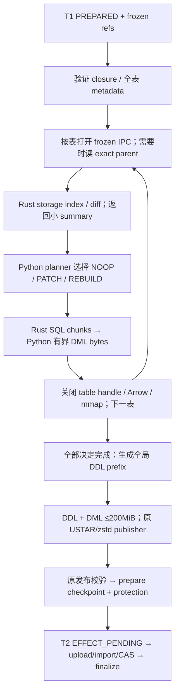

# Phase 6 S4：Submit 渲染直通详细设计

2026-11-08。状态：设计候选，待独立设计审核；不是产品实现、测试结果或实施放行。
配套 [kickoff](p6-s4-kickoff.md)、[独审提示词](p6-s4-review-prompt.md)。

## 1. 起点、决策与范围

只读核查起点 main=`572359d3a7`，staged/tracked/untracked 均空；已有前端、原基准和大量 detached 审核 worktree，不接管、不回退、不清理。S1a/b/c、S2a/b 已有 exit tag，S3/S4 没有 exit tag。

- S3 A–D 各自 GO；产品 V=`774acf33a3f12eeccfbb440d9446ffde9c1c6d43`、H=`685c97f4e275e5e52b42ea403a07a5e96b0695b2`、终审=`0bf64540389e13b80735b483e1b9616bf8dca1e0`，仍为 **BLOCKED_CAPACITY**。见 [累计交接](p6-s3-candidate-handoff.md)、[容量报告](p6-s3-e-capacity-stop.md)、[E review §61–64](p6-s3-e-review.md)。后续 DC92 允许设计独审后提前实施 S4，不倒签 S3，不放行 S5。
- Q18 产品=`a1ca3bad93a25cb47384a81fbc985075b1299c39`，[独审](p6-be-q18-review.md)静态 CLEAR、节点证据待核；不等于 FE3c 前置解除。S4 不修改其 API，也不更改生成时间诊断。FE 交接依据 [S3 coordination §16](p6-s3-coordination.md#16-fe3c-q18-与生成时间预期当前事实和建议交接)。
- 生产 N1、单 active、worker 32 GiB、reserve 8 GiB、M24 GiB 不变。五节点按 DC91 为统一池；16:00Z 只读 BatchMode 核查五节点均连接成功、无 busy marker、无运行 Docker 容器及 8000 listener；不是预约或执行准入，未扫描全机进程/缓存，不声称环境就绪。
- 本轮 Owner 已确认：① Submit 按存储键独立判断，前端比较键不同不单独迫使 rebuild；② DC33 范围见 kickoff §6；③ 恢复以 prepare checkpoint 是否持久化区分，非 INITIAL 缺/坏 parent manifest 继续拒绝。均不改现有产品行为、SQL、状态机或阈值。

目标是移除 Submit 热路径的逐行 Python 对象和无消费者摘要，保持同输入 `replay.sql` 逐字节一致。保留通用 planner/ChangeSet、替换规划器、小型 metadata、发布和恢复。明确不做 S5 缓存、FE 功能、Q18、生产加预算、跨进程计算服务、通用 SDK、永久双引擎或新 durable 状态机。

本方案是技术细化；正式语义 owner 仍为 [Storage Mutation](../contracts/storage-mutation-and-change-set.md)、[Canonical Storage](../contracts/canonical-storage-and-repository-boundary.md)、[Shared Encoding](../contracts/shared-canonical-encoding.md)、[ADR0014](../adr/0014-adaptive-patch-and-target-neutral-change-set.md)。Safe Rust、单信任域和验证取舍遵守两份 [Rust](../policies/rust-safety-and-performance-policy.md)/[比例化](../policies/proportional-assurance-and-risk-based-verification-policy.md)政策。

## 2. 当前生产证据与替换边界

以下 B 相对 `vnext/backend/src/gateway_backend/`，R 相对 `vnext/rust/`；均是上述起点的源码事实。

| 证据 | 缺口 | 方案及 owner | 验证/停止 |
| --- | --- | --- | --- |
| B `infrastructure/repository_write/import_publication.py::build_and_publish` 先预约 `16MiB*32 + 200MiB*10 + 16MiB = 2528MiB`，打开所有 frozen inputs | 输入批量常驻，后续又 reopen；replay/package 与 Python 行上界并存 | 逐表打开，保持完整绑定验证；本阶段保留现有 package 预算和字节 API | 实际账本包含所有同时驻留；不能只看 RSS 缩预约 |
| `_reserve_submit_python_rows` 为每表预约 `logical_size*32 + rows*(columns*1024+2048+name_chars*64)+64KiB`，挂 operation ExitStack | Python 行、字典、digest、索引、ChangeSet 及预约跨表累积 | native 表级 owner；表结束释放；删对应 Python 分配后才删预约 | 双表顺序处理后前表输入/索引 charge 不继续累积 |
| `_build_frozen_projection` → `_keyed_rows_from_frozen_artifact` → `build_import_mutation_snapshots` → `plan_import_mutation` → `render_planned_import_mutation_dml` | typed rows 转 dict/tuple、重复编码/排序、构建无持久消费者 ChangeSet | Mutation Planning 的 storage task + Rust renderer；Python 保留表级 policy | SQL/golden、逻辑计数、parent 校验不变 |
| `_materialize_parent_rows` 一次请求全部 patch-comparable 表 | 已提交副本和转换结果一起存活 | 按表调用现 materialize/committed-table port，精确 commit、缓存 miss 回 Dolt | 每个需要的 parent 表至多一次正常物化，不以 current main 替代 |
| `_render_limited_mutation_batches` 每加一行重渲染整批 | UPDATE/DELETE 编码量随批大小平方增长 | 增量完整语句长度；保留旧 256 行窗口边界 | 4MiB/256 交叉边界逐字节，不能改成不同的贪心批次 |
| schema SQL 全部拼在 mutation DML 前；publisher 只接 bytes | 逐表 DDL+DML 交错会改字节；直接换流式 tar/zstd 会扩大范围 | 有界 DML 字节汇集，全部决定完成后生成 DDL 前缀并交原 publisher | 全部 DDL 在前、包 raw golden 不变；不引入磁盘 spool |

容量依据仅为：W3 MO warm 在 v1 Submit 的 `OperationMemoryBudget.ensure` 拒绝，尚未到 v1 Archive/v2 比较；首次 stage/表/requested/live 未知。2528MiB 是源码预约，不是测得物理占用；Python 上界累积是机制假设，不是已证首拒原因。原 20.338GiB DDL 粗估不用于选 M。

## 3. 存储任务与表级决定

### 3.1 三个身份域

1. 存储输入：T1 冻结 canonical IPC，完整 retained/persisted 列，含 ordered `gid/no` 与结构列；不读 Preview records，不套 comparison 的共有列、exclude、风险截断、LIS 或显示身份。
2. 存储键：manifest 的 `canonical_key_columns`；ordered 为 `gid`，`no` 是可更新的普通列。伪 gid 保持规范投影生成值，不能重建、剔除或转换为前端空白身份。
3. SQL 顺序键：现 `key_bytes_for_ordering` 的 CanonicalStorageKey document 的 JCS UTF-8 bytes。键列数组按 canonical 名 UTF-8 排序，JSON object 属性仍用 JCS UTF-16 序；整数十进制字符串不按数值排序。与 S3 effective-key hash 不同。

Keyless 保留重复行；重建 INSERT 按现 `(empty-key JCS, mutation row_digest)` 排序。这里的 mutation row digest **仍有排序消费者**，不能替换成 IPC 物理顺序或 raw-content digest。SET 的 mutation image 为声明顺序逗号拼接文本；业务表 content 则使用 Shared Encoding 的 sequence frame，两种摘要不能互换。只移除 plan/change-set identity、自校验等 Submit 无消费者的计算，不承诺删除所有行 hash。

### 3.2 决策矩阵

Python `mutation_planning` 拥有唯一的轻量表级选择函数，通用 planner 与 Submit 新 facade 共用它；Rust 计算精确事实并按已经选择的策略渲染，不暗自改变 policy。

| 输入 | parent 行需求 | 决定 |
| --- | --- | --- |
| 两侧完整身份相等：row count、source/canonical schema、content、storage view、projection version | 无 | NOOP；不产生 SQL |
| INITIAL 或新增表 | 无 | REBUILD_TABLE，DROP IF EXISTS + CREATE + 全部 INSERT；空表仍有 DDL |
| 删除表 | 无 | DROP；不生成逐键 DELETE |
| projection version、canonical schema/key/retained/storage view 不同 | 无 | REBUILD_TABLE，不为将被丢弃的 before 构造行对象 |
| changed keyless 或无稳定键 | 无 | REBUILD_TABLE，重复行全保留 |
| 两侧同 canonical schema/view、稳定唯一键，before>0 | 需要且须核验 | storage diff 精确计数，零变化为 NOOP；否则同时满足 changed≤1000 且 `100*changed≤max(before,after,1)` 才 PATCH_DML，否则 REBUILD_TABLE |
| before=0、after>0 | 不需为阈值读取空 parent | REBUILD_TABLE |
| unsupported/degraded/重复键/坏绑定/未建模副作用 | 不以重建绕过 | effect 前稳定失败 |

source schema 变化但 canonical schema/view/rows 相同，在 **patch-comparable keyed、实际读取完整 before** 的路径上，当前适配器的初筛可选中、通用 planner 最终仍判 NOOP。保留这一现行差异，统计分列 `manifest_candidates`、`storage_noops`、`replay_tables`，不能为满足粗略 X 集合公式强写一张无变化表。这个例外不扩至 keyless：现 Submit 不读其 parent rows，初筛选中的 keyless 仍 rebuild。projection version 不同必须先于 NOOP 判定。非 INITIAL 缺/坏 parent manifest 或与 parent catalog 不一致继续拒绝，不合成空 parent。

净 diff：同键完整 persisted image 变化 UPDATE=1；键变化 DELETE+INSERT=2；多列变化不放大；重复键不允许字典覆盖。浮点/DECIMAL 规范负零等价沿 Shared Encoding；SET/ENUM/JSON 按现 canonical adapter 的逻辑值。行比较可逐列借用编码短 scratch，不能先构造全表 scalar graph。

### 3.3 共用内核和新接口

新增 R `gateway-compute-core/src/storage_mutation/`（storage view、索引、diff）与 `sql_replay/`（literal、batch、DDL/DML）。共用 S3 的 Arrow 行定位、类型校验、规范 cell 编码、可取消排序、资源 lease；需要解除 `comparison::ordered` 私有依赖的最小部分提取为 core 内公共模块，comparison 跟随改 import，保持原返回错误映射。不要让新 storage task 直接调用 `compare_records` 或构造三族 records。

设计调用契约（名字可在 A 固定，含义不可缺项）：

```text
StorageTableTaskV1:
  table identity + before/after existence
  canonical schema/profile + DDL layout + retained/key columns
  projection/storage view + frozen count/content bindings
  Arrow streams with explicit schema (empty != absent)

prepare_storage_table(task, operation) -> StorageTableHandle
handle.summary() -> before_rows/after_rows/comparable/net_counts?/validated identities (small)
choose_table_mutation(metadata, summary, frozen_threshold) -> decision  [Python]
handle.render(decision) -> bounded SQL byte chunks
handle.close()
```

prepare 对可比较表建立 `(JCS key, row locator)` 索引并校验唯一，排序 merge 扫描，使用 full persisted 值决定净变化。最多保留1000个 patch action locator；超过上限继续计数但不继续存 mutation 列表。重建只留 after 顺序索引，释放 before/index/patch 临时结果；keyless after 另算旧 mutation 排序 hash。已执行diff的D/U/I计数不因提前判rebuild被截断。

新Submit summary不是通用`TableMutationSummary`：未读取before/未做diff的强制rebuild明确 `net_counts=None`，只报告before/after行数、decision/reason及实际INSERT行数；不得填0或before+after冒充净差。现Submit只消费旧summary.operation（`import_publication.py`279–286）；keyless父表被`_patch_comparable`排除、旧planner收到真实manifest+空rows，旧changed_row_count本来就不是完整keyless净差。删除这个无消费者的Submit摘要，不为了保留它读parent。通用planner/ChangeSet及其完整输入计数完全保留，例如100行仅换1行的keyless净差仍为2；它选择rebuild不将净差改为200。

R `gateway-compute-python/src/storage_mutation.rs` 接 Arrow C Stream 所有权转移，用第三方公开 safe API；粗粒度 table/byte-chunk 调用，compute/sort/render 释放 GIL。B `capabilities/mutation_planning/native.py` 为唯一新增 FFI owner，精确登记 `_begin_storage_operation_native`、`_prepare_storage_table_native`、`_render_change_set_native`；DDL 的 `_render_storage_schema_native` 由已有 `storage_projection.native` owner 暴露薄函数，schema facade 经它调用同一 Rust SQL 模块。**Storage Projection 不反向 import Mutation Planning**，不能为复用产生 capability cycle。最终命名随 A 同步政策和 import guard，不放开整个 capability；调用者不直接 import 私有 native。core 无文件、ArtifactStore、backend 对象或业务状态。

复用进程池 N 和同一个 operation M。native portion 是 Python 已预约的子额度，Rust leases 在其中分配；不得当第二份独立 M。表 handle 无 checkpoint/持久版本轴；V1 只为进程内输入契约辨型，不新增 SDK、服务或部署参数。首个独立消费者的公开 API/打包仍按总设计 §1.5，S4 只落实当前真实消费者的单向边界。

失败映射保留两层语义：core返回code/message和有界stage/table诊断；backend取消/截止/资源错误继续为现`InterruptedError`/`TimeoutError`/`KernelMemoryLimit`，不得全包成publication error丢失worker原分类。一般输入/能力/SQL cap失败通过现ImportReplay/SubmitPublication错误边界；通用renderer继续返回原`ReplayRenderOutcome`的`TARGET_CAPABILITY_UNSUPPORTED`或`RESOURCE_EXCEEDED`。意外panic是内部失败，不返回SQL或假装unsupported；不新增HTTP/Repository public failure code。

### 3.4 两个保留facade的执行契约

本项目没有已部署调用方，不保无预算旧调用签名或隐式初始化兼容层。C直接改为：

```text
render_change_set_replay(closure, *, context: KernelExecutionContext,
                        expected_renderer_capability=None) -> ReplayRenderOutcome
render_repository_import_schema_replay_sql(import_input, *, removed_tables,
                                          context: KernelExecutionContext) -> bytes
```

context必填、须处在caller管理的kernel_execution_scope，携带有效M、N、cancel_probe和deadline；公共facade不以ContextVar作为隐藏前置、不自建第二池、不默认M、不在首次调用初始化。进程入口先显式初始化共享池，N不符/池未初始化按现native初始化错误拒绝，关闭context后不能再调用。worker从已建立的operation传同一context；不是给通用消费者绕开准入的接口。

通用closure是调用方已经拥有的结构化输入：其创建/驻留预算由caller负责；facade入口将其作为显式输入驻留计入同M（已由caller登记的同backing不得重复收费），随后先预约转换/Arrow、索引和output上界再分配。转换只服务通用ChangeSet，不是Submit行路径。保留facade返回的bytes/outcome形态：不能早于最后使用释放预约；保守做法是把其结果charge保留到caller的operation scope结束，调用方不得把结果交给另一个未计费operation。转换scratch在调用结束释放。Submit的持续DML汇集由package envelope计费；schema结果如由facade独立保留charge，须从该envelope对应预留中划出或保守额外预约，并在下一阶段明确释放，不能借“已预留”无owner地跳过计费。

迁移点：production `import_publication.py`传当前有效context；删除import wrapper后无旧隐式调用。现通用调用位于`test_dolt_renderer.py`、`test_mutation_planning.py`，schema调用另在`test_storage_projection_import_replay.py`、`test_submit_import_builder.py`、`test_canonical_snapshot_identity.py`和待移除的import replay测试。C让现`tests/conftest.py::operation_kernel_context` fixture显式yield其context给这些调用，仍复用现session pool初始化；不复制新全局fixture/默认预算。加一个真实已安装扩展的显式context调用及无有效context拒绝断言。capability digest、SQL和结果语义不变；这是内部调用签名迁移，不声明独立SDK已交付。

## 4. SQL 精确字节与分批

权威原件：S1a 产品 `7d0ce6220ac2541b76ab75191d43ce6113003966`、[handoff 阈值节](p6-s1a-handoff.md#dolt-语句规则阈值实测与哈希核对)、[终审 §7](p6-s1a-independent-review.md)；当前 `mutation/renderer/valid/*/expected.sql`、`test_dolt_renderer.py`、`test_storage_projection_import_replay.py` 与包 golden。不得由新 Rust 输出反填 expected。

### 4.1 顺序与语句形态

- 最前面为删除表 DROP，按表名 UTF-8；其次所有 rebuild 表的 DROP+CREATE，按表名 UTF-8；最后所有表的 DML，按表名 UTF-8。每表 DELETE→UPDATE→INSERT，各阶段 JCS key 升序，keyless rebuild 按 §3.1。所有语句结尾恰 `;\n`。
- DDL 列/primary key 保持 manifest 的 DDL 顺序；INSERT/UPDATE after-image 列按 UTF-8 名排序，不能直接沿 Arrow 物理列序。UPDATE 对全部非键 persisted 列写 CASE（包括值未变列），不是仅 changed columns。
- DELETE 单键 `WHERE \`k\` IN (v1,v2)`，复合键 `WHERE (\`a\`,\`b\`) IN ((a1, b1),(a2, b2))`；精确保留逗号/空格。
- UPDATE 为 `SET \`c\`=CASE WHEN key_pred THEN value ... ELSE \`c\` END, ... WHERE key_batch`；key_pred 复合项用 ` AND `。不改 upsert、不增加 affected-row guard。重建已有 DROP+CREATE，不输出 before 逐键 DELETE 或额外 DELETE FROM。

### 4.2 标量和拒绝

| 值/边界 | 冻结 SQL |
| --- | --- |
| identifier | backtick 包围，内部 backtick 加倍；空、NUL、`/`、反斜线拒绝；不引入 shell |
| NULL/boolean | `NULL`；`TRUE`/`FALSE` |
| integer/DECIMAL | 已规范十进制文本，无引号，不经 float |
| float32/64 | 解 bits 后沿现 Python `.15g` 字节，包括指数选择、符号/零填充及负零归0；不是 Rust 默认 Display，也不是 Shared Kernel bits_hex 的 SQL 拼写 |
| string/JSON | 使用现 canonical 字符串，单引号包围；JSON 不重解析/重排，不新增 JSON cell kind |
| escape | 反斜线、单引号、LF、CR、NUL、TAB 分别为 `\\\\`、`\\'`、`\\n`、`\\r`、`\\0`、`\\t`；其他合法 Unicode 原 UTF-8，无 normalization |
| binary/BIT | `X'大写hex'`；`b'每原字节8位binary'`，保留 leading zeros |
| date/datetime/timestamp/time-duration | 引号内保持规范文本；UTC/civil/duration 区别不重解释 |
| ENUM/SET | ENUM label 字符串；SET 按声明顺序拼逗号，空 SET 为 `''`，NULL 仍 NULL |
| anomaly/非法 profile/非有限 float/不支持类型 | typed capability/input failure，不能 stringify、降级或自动 rebuild |

`.15g` 在 A 固定独立向量：float32 先升为精确 binary64 值再格式化；15 位有效数舍入、指数边界 -4/15、指数至少两位且显式正负、去小数尾零。实现可用 Rust safe 标准格式化生成15位科学记数并按舍入后 exponent 选择 fixed/scientific；必须经独立边界向量证明完全相同。若出现冻结 renderer 本身的精度问题，另交 Owner，不能借 S4 改 SQL。

### 4.3 增量长度算法

每个 operation/column identity 独立合批。INSERT 贪心累计前缀、各行 bytes、`, `、`;\n`；256 行或下一行导致多行超过4MiB时 flush。DELETE/UPDATE **先按原连续256行窗口分组，再在窗口内按4MiB分批，窗口末强制 flush**。byte flush 不重置原窗口计数。此细节来自现实现，避免在第256行边界换字节。

DELETE：固定 prefix/suffix + key tuple 字节和 + 逗号数。UPDATE：固定 table/SET/ELSE/END/WHERE/suffix + 每列 CASE branch 字节和（每增加一行每列多一个分隔空格）+ WHERE key tuple 字节和/逗号。每行仅编码一次 predicate、key tuple 和各列 value；predicate 的重复输出按每列重复计入长度。采用 checked add/mul；不每加一行重渲染已有批次。超过4MiB的单行独立成句，仍受总200MiB限制。

输出每 chunk 目标≤1MiB，可拆开 SQL 语句或 UTF-8 多字节序列，Python 只按 bytes 拼接、不独立解码 chunk；总流为合法 UTF-8。normal batch buffer≤4MiB；单行大语句先计算完整长度并检查总剩余额度/内存，按片段输出，不要求额外分配整个超大 SQL。Rust 只保一个待发 chunk，Python 同时只接一个；禁止 unbounded producer queue。精确最终 admission 为 `DDL_bytes + DML_bytes ≤ 200MiB`，等号允许；包含删除表 DDL。溢出前拒绝，不拆包、不回退，不先发布可用 checkpoint。

## 5. 数据流、内存与最后消费者



DML 先在内存汇集，但最终包顺序仍 DDL 在前；不对 Repository 发送任何未完成流。SQL cap 已有限，本轮不引入 spool/增量 tar/zstd，因此压缩参数、包字节与恢复接口不扩大。

| 阶段 | 同时驻留与预约 | 释放点/owner |
| --- | --- | --- |
| metadata | closure、全部小 descriptor/import table/summary；metadata 按现预算规则 | operation；不保所有 mmap/行 |
| 单表 input | 当前 after mmap + 必要 before mmap/Arrow，以及实际非共享转换 buffer | canonical reader/Arrow backing owner；相同实际 backing去重，不能按内容摘要假设同份 |
| native compute | key JCS bytes+offsets、行定位/排序 scratch、必要 mutation hash、bounded patch locators、cell scratch | native leases；预估在分配前、增长前再检查；rebuild 决定后尽早释放 before |
| render | after/必要 before借用、排序索引、≤4MiB普通batch片段、大行片段、≤1MiB chunk与跨FFI复制 | table handle结束先释放native Arrow，再关闭streams/readers/mmap；异常同序 |
| accumulate/package | DML≤200MiB、DDL、拼接副本、manifest AST、USTAR、zstd、发布readback/解压 | 保留原2528MiB package/replay预约，覆盖这一区间；不把它重复算为native index额度 |
| verify/upload | 现 `submit-package-verify` 与 `submit-package-readback-bytes` 及 upload consumer | 保留现 owner；本轮不调整该恢复路径预约 |

预算公式：`peak = resident_metadata + unique_input_backings + active_native_portion + package_replay_envelope + other_actual_operation_residents ≤ M`。native portion 不含已计费输入，不包含已由 package envelope 预留的 Python accumulator；native chunk/cell/index自身必须明确计费。包预约保持2528MiB，native portion 只能从扣除全部现有驻留后的 available 取得；封存子额度后不能再增长借用。归还子额度前，native任务必须完成且全部native buffer已释放；不能只有 handle.close 而导出对象仍存活。

内核实现使用 `size_of`、实际 Vec capacity、checked arithmetic 和可变长编码上界，而非仅估平均列宽。分配 key/row frame 前由 Arrow length 与声明 metadata 计算上界；sort 同时计输入和辅助索引。超大单元格、UTF-8转义膨胀、CASE多列重复、SET标签头、BIT物理转换均进入预算；输入全表 mmap 也按完整 mapping size 计费。表级串行、输出顺序固定；不引入新并行 fan-out，测试 N>1 仅证明共享池确定性，不修改生产 N。

frozen wrapper/closure/descriptor/schema/key/source identity/raw SHA检查全部保留。NOOP 表也按现冻结完整性边界逐表打开验证并立即关闭，只是不构建行 diff/SQL；不能以 manifest 相等绕过坏 frozen 文件。parent reader 保留 count 与 raw-content 校验：业务 content 可复用已验证 canonical reader 的结果，否则由 canonical owner 计算，不以 mutation 行hash替代。已提交副本坏/缺才从精确 commit 读取并核验回填；冻结上传侧失败不回源重建。

取消/截止在打开、索引循环、排序、编码/大行分片、publish前后检查，复用 existing control 的更早 deadline。FFI panic 映射稳定内部错误，不返回部分结果；abort/进程死亡仍由 Operation Runtime 接管，不能声称 catch_unwind 能恢复 OOM/segfault。退出路径用 context manager/RAII，任何下一表打开失败也关闭之前对象；无GC才能正确释放的前提。I/O/预算/取消失败不生成可用 checkpoint；孤立已写产物沿已有 cleanup。

S4 不预先承诺原 M24 必过。改善来自 `sum(各表Python对象上界)` 换成 `max(当前表列式输入+索引)`，同时去除全量ChangeSet/digest和重复SQL编码；仍保留package峰值。D/E 用真实 descriptor 账本、RSS/cgroup和磁盘共同校准，任何超过 M 的单表稳定拒绝；需要改预算或包 API 时另交 Owner。

## 6. 消费者与删除清单

| 现接口/实现 | 已核消费者 | S4 处置 |
| --- | --- | --- |
| `mutation_planning/import_replay.py` 的 build/plan/render import wrappers | production仅 import_publication；测试 `test_mutation_planning_import_replay.py`、identity/builder support | 用新Submit facade替换，删除无剩余调用的wrapper及专属重复测试；保留业务断言到native/adapter |
| `_keyed_rows_from_frozen_artifact`、`_mutation_cell_from_frozen_artifact`、`_mutation_snapshots_from_repository`、`_reserve_submit_python_rows` | Submit adapter | 删除Python热路径，native typed view与表owner接替 |
| `ImportReplayKeyedRow/ImportReplayTableSnapshot` | 上述wrapper及 `tests/support/native_projection.py` 等 | consumer移交后删只供旧import桥的类型/export/support，不删ProjectionResult/manifest |
| `_planner.py/_changeset.py/contracts.py/_artifacts.py` | 通用planner/ChangeSet公开契约和其测试，external target责任 | 保留，抽出小型共同decision predicate；Submit不再调用通用ChangeSet构造 |
| `_digest.py::row_digest_from_image` | 通用planner、`external_target_sync/_ledger_digest.py` | 保留独立consumer；Submit使用Rust必要排序hash，无全量Python image |
| `_repository_replay_renderer.py` | 通用 `render_change_set_replay`/capability及 `test_dolt_renderer.py` | 保留公开facade、capability和错误形态；SQL算法移到唯一Rust renderer。通用closure的受限Arrow适配只供其已有结构化输入，Submit不绕回closure；删除旧Pythonliteral/batching算法 |
| `storage_projection/import_replay.py` | Submit schema renderer及schema tests | 保留公开schema facade和metadata责任，调用同一Rust DDL编码；不另保Python SQL算法 |
| `storage_projection/publish.py/package.py` | Submit、公开open/validate/package tests、恢复 | 保留原bytes打包、发布后的manifest/package回读与语义校验；本轮不把有消费者校验当无用删除 |
| `read_back_package/verify_checkpoint_semantic_binding` | prepare复用与upload路径 | 保留；与“新写records不回读”的S3决定不同 |
| comparison metadata、replacement planner、Risk/History/FE | 各自现役consumer | 不删除/合并；只因共用kernel抽取做定向回归 |

通用renderer是明确保留的公开契约，不是旧Python oracle：调用相同Rust SQL编码和分批内核，保留其keyless `DELETE FROM`等通用模式（Submit rebuild则抑制这些DELETE）。其通用ChangeSet/sql_digest等实际consumer仍计算；不能把Submit去摘要政策扩到外部ledger。新增适配如需额外内存，沿调用方显式operation context计费，不给无预算的旁路。

测试期可临时对旧代码做差分，D之前完成捕获并记录固定旧SHA/输入/expected来源；D删除临时入口，git历史可追溯，不把完整旧算法移到tests长期维护。固定SQL、计数/性质、真实Dolt结果仍保留。

## 7. 事务、恢复、保护不变量

精确状态来自 `accept_transaction.py`、`submit_jobs.py`、`import_builder.py`、`effect_pending_transaction.py`，以及 Business Lifecycle/Operation Lifecycle/Repository Service Contracts：

1. T1 已创建 **PREPARED** Attempt，冻结expected technical main、业务baseline、Preview refs、policy、scope与幂等输入，转移保护。PREPARED 不表示包已完成。
2. 没有prepare checkpoint时，只从T1 frozen refs准备包；冻文件缺/坏稳定失败，不从SourcePackage/新ruleset/parent补上传侧。未发表checkpoint的纯计算可按原机制重算。
3. prepare checkpoint持久化后，原manifest/package refs、size/raw SHA和parent manifest binding必须复用；原`reuse_prepare_import_checkpoint`先验证全部绑定。缺/坏包不得重建或换key；不是以重新渲染“相同SQL”作为恢复。
4. T2进入EFFECT_PENDING后沿原upload/import idempotency key、独立RepositoryArtifactRef和operation ID；expected-parent CAS、STRUCTURAL完整catalog、marker/reconcile、unknown outcome/manual recovery保持。
5. Submit finalize保存Submission/技术main结果并释放Attempt/checkpoint保护，**不推进业务BaselineHead**。真实Review和Archive继续；Archive既有事务唯一推进业务head及引用，不能在SQL生成时提前改变。
6. 原权限/scope、保护引用、失败回滚、取消/租约/截止、重复请求重放保持；不增加持久验证token、恢复状态或控制DB schema。

包manifest仍列全部目标表而非仅变更表；schema/rows由原RS STRUCTURAL校验。Dolt表结果测试属于验收，不新增生产提交后全表readback。业务CAS、跨scope和保护引用由现测试owner证明，不为每个内部chunk加crash状态机。

## 8. S3诊断、性能归因和退出

S3-only诊断候选不含S4，先最小记录失败stage/table/requested/live/limit/high-water和owner生命周期，以实际canonical descriptors复算；表名/输入内容不泄漏到公共错误。复用`stage_admissions`，必要诊断仅有界外置日志，不建DB。S4复用相同计量字段用于前后解释；共享`kernel.py`由协调者顺序分配写入。

临时提高M/envelope的方向已认可，但数值和完整执行稿仍未定，归S3诊断owner；本S4不依赖它。若用大预算准备再M24计时/换worker，另场景标识，不删除same-worker守卫、不计原全旅程容量通过。保留CT108原失败归档、04 carried来源WT及原冻结基准；不拿归档冒fresh输入。

每次报告：metadata/frozen打开、parent读取/校验、storage index+diff、SQL编码、bytes拼接、USTAR/zstd、发布回读、checkpoint/step等待、RS upload/import/commit/CAS、Submit受理至完成main前移。嵌套段标包含关系不重复相加；Archive另计。记录候选表/NOOP/PATCH/REBUILD/DROP、parent逻辑需求/IPC打开/Dolt回填、native调用、逻辑D/U/I、SQL语句/字节、各阶段预约/高水、RSS/cgroup、磁盘临时峰值。

S1首次和S4几乎全变Submit≤5min，S3少量变化≤2min，所有Submit≤10min；S2原样重传无Repository operation。这里S1–S4是负载名，与实施阶段同名但含义不同。正式同条件1warm+3，median/range；失败不计成功统计，压力100%只报告仍需正确性。冻结N4历史预算不当作当前N1测得值。

S3-only候选、S4候选与joint候选分别固定。含S4结果不归为纯S3比较改善，不倒签774；W2无行比较。代码正确、功能容量、性能达标、压力结果、未知分别报告。DC81允许未达性能带证据交Owner重新讨论，不自动豁免S4退出条件。S5仍等S3/S4各自exit。

## 9. 设计关闭与实施未知

设计已给出语义、顺序、接口、预算owner、恢复、消费者和验收方案；是否可作为开工设计由独审判定。本轮三项Owner决策已收齐。尚未产生任何新SQL/代码/运行证据。

必须在实现中证明、不能写成设计已通过的项目：旧mutation排序hash/float拼写等价；每类分批交叉边界；跨FFI最后owner；2528MiB包预算内新增汇集方式的实际峰值；原M24完整2×t4及Submit目标；S3-only拒绝点和临时预算参数。实现发现语义/SQL/golden、FE接口、生产资源、恢复边界必须变更时停受影响工作，给最小反例和选项交Owner；不自动扩大本设计。
