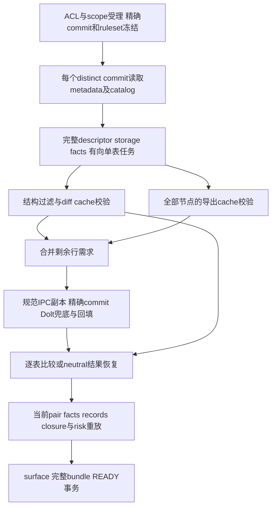

# Phase 6 S5 History 与跨操作缓存详细设计

状态：**DESIGN_CLEAR；Owner已授权完整实施A–E，A/B已独审GO，准备C**。当前权限见[实施任务提示词](p6-s5-implementation-prompt.md)。设计独审绑定候选`75267e9a72cfb9f428b1c1e5182c1fe55f6e697f`及原审原文保持；设计源码基线 `4c648965286ec751c4395cd6111f11838610299c`（main），2026-11-09。
实施顺序与当前验证见 [kickoff](p6-s5-kickoff.md)，固定设计候选独审见 [review](p6-s5-design-review.md)。本稿描述完整目标，§1的实现观察以设计源码基线为准；实际已交付及未测边界分别见[A交接](p6-s5-a-handoff.md)、[B交接](p6-s5-b-handoff.md)，不以设计CLEAR代替产品或阶段退出GO。

## 1. 范围、事实与决定

S3、S4正式退出仅解除阶段前置。设计轮已完成。Owner现已授权按[实施任务提示词](p6-s5-implementation-prompt.md)完整推进A–E；只有实质阻塞才确认，不推送。S6/P7、跨operation调度、通用SDK、缓存平台、磁盘容量淘汰不在范围。

- S3 V=`4b0a2eec725bffb0cf2e753df5f3e5d90e26c3fb`，H/tag=`f9ef26081dfd4710d3709d9f5fbca24543f84de4` / `p6-s3-exit`。
- S4 V=`6786b28a3506feab3d8eac7d1288c8b22525bb8f`，H/tag=`1e778aae0522db75ea1f507ecfa83a6d7b714d65` / `p6-s4-exit`。当前Rust tree=`e2a901417b19259ece669637a41545e774261445`。
- S3历史已通过`87f4ae305c48cd06dfd3033f41c5a8b50ac3ebfc`合回，merge tree等第一父；本稿基于main的S4产品树，不能把S3证据移作当前产品验证。
- 默认N1、单active、worker32GiB/reserve8GiB/M24。S4的48/8/M40成功不证明M24或S5容量，S3原大负载失败与取消项不移交为S5必测项目。
- Owner本轮确认DC33范围为标准t1 v1/v2，合法存量提交可复用，只跑必要History冷查、复查、真实records/bundle读取；FULL、三节点、损坏、恢复由focused/Contract覆盖。实施与必要验证已按本次Owner授权开放。
- Owner本轮确认节点按main DC91/DC97统一空闲池；另授权AGENTS及相关执行说明只保留最新要求。历史handoff与原审证据保持原样。

### 1.1 已核实现和缺口

以下B指`vnext/backend/src/gateway_backend/`，T指`vnext/backend/tests/`；位置以源码基线为准。

| 对象 | 状态与源码依据 | S5处理 |
| --- | --- | --- |
| History受理与节点解析 | 已实现；B`application/history/compare.py`的`accept_history_compare`、`resolve_compare_nodes`、`validate_history_compare_binding`，`compare_bindings.py`冻结scope/repository、ordered nodes/commit、ruleset digest | 保留ACL、幂等、方向和绑定；缓存不参与授权 |
| 2/3节点、checkpoint、READY | 已实现；B`application/history/compare_jobs.py`的三step、`_assemble_comparison`、`_bound_from_side_document`；2节点A→B，3节点A→B/B→C | 保留外部行为，调整内部描述/按需行读取与恢复 |
| 逐表结构过滤 | 部分实现；`_history_requested_tables`用view/identity/projection相等过滤，ordered U仍请求current；`pair_pipeline._same_complete_table_identity`与Comparison owner判定 | 用共享完整事实规划，命中裁剪需求，不能只比较raw digest |
| 实际行读取 | 有缺口；`_materialize_distinct_commits`传全部`export_tables`；B`capabilities/snapshot_materialization/repository_ref.py::_materialize_open_session`对requested∪export直接`load_table` | 即使导出cache命中仍打开所有规范表，缺副本触发Dolt；改metadata先行、需求合并后ensure_rows |
| operation内去重 | 已实现；B`capabilities/comparison/production.py::ComparisonTaskSession`、`_task_key` | 当前repr含artifact/reader id，不能持久化；共享新的纯任务投影，保留有预算的短期handle复用 |
| 跨operation diff/risk缓存 | 未实现；目前session仅保native handle和风险事件 | 新增单表键/内部值格式/持久索引与TTL |
| 规范表缓存 | 已实现；B`application/canonical_metadata/table_access.py::CanonicalCommittedTableAccess`、canonical store与SQLite index | 保留exact commit校验/回填；非T1冻结内容的替代来源 |
| Parquet导出缓存 | 已实现；B`artifacts/snapshot_table_export_cache.py`、`infrastructure/control_db/sqlite_snapshot_export_cache.py` | 保留独立row-layout+writer+repository key；让History提前查询 |
| 风险纯边界 | 部分实现；B`capabilities/risk_evaluation/_engine.py`的`_RiskCandidateRecorder`、`_RiskCheckClosure`、`_evaluate_table` | 内存序列含控制事件；新增可持久的neutral候选，不缓存前次closure验证结果 |
| Submit finalize | 已实现业务屏障；B`application/submission/finalize_transaction.py` | 在T3短事务触达该Preview已存在缓存引用；不移动BaselineHead、不重做publisher |
| 503/读取预算 | 部分实现；client已有502/503三次有界退避；B`infrastructure/repository_read/http_arrow.py`已有Arrow spool/mmap预算 | 接通operation取消/截止到等待与重试；不叠加第二套重试 |
| 真实records消费者 | 已实现；Comparison artifacts的open/restore完整语义验证，History HTTP bundle/tar及FE本地消费 | 缓存恢复须接真实reader，不能以raw/ref检查替代records验证 |

### 1.2 设计冲突与处理

| 冲突 | 决定及理由 | owning修订与验证owner |
| --- | --- | --- |
| `comparison.md`的Comparison Core Cache与`artifacts.md`仍规定pair-level/JSONL，DC43已要求单表纯结果 | 直接替换旧条款为本稿§3–5，不留pair缓存兼容实现 | Comparison/Artifacts；cache key与恢复Contract测试 |
| `p6-design.md`§11仍称finalize移动head，与§8.2及源码矛盾 | 改为T3提交Submission时可选触达TTL引用；业务Head仅Archive CAS | Submission/Canonical Storage；finalize事务测试 |
| bundle Contract已要求先查导出缓存，而History当前先load全部表 | 补齐按需读表，不通过放宽零读断言掩盖 | Snapshot Table Access/Bundle；History需求集成测试 |
| 旧“缓存健康则零Dolt”未区分diff、导出及规范表 | §9明确独立需求：diff健康只保证零比较；全部所需导出或规范副本健康才保证零Dolt行读 | 总设计计数条款；History计数测试 |
| 旧H2合成2×t4/三节点整旅程与DC98不符 | 采用Owner本轮确认的t1定向范围，无重复统计硬门槛 | kickoff§5；一次真实读取 |
| P5-5E设计的policy/checkpoint文字仍描述旧实现 | 以当前ruleset digest匹配与checkpoint验证为基线，明确冻结任务投影；不恢复旧Python算法 | History/operation lifecycle；checkpoint恢复测试 |

风险分类：commit绑定、scope与事务为A；现有operation/checkpoint为B；diff/risk/导出/已提交IPC副本为C；序列化helper为D。缓存不是新恢复事实，不建立journal、sidecar、独立UID/helper或恶意同euid pathname证明。

## 2. History完整数据流

1. `accept_history_compare`仍在一个control DB快照解析2/3个node；冻结repository/device/project、节点顺序与精确commit、ruleset digest、contract/view身份。caller不直接传commit/path，不按时间排序或补pair；同commit和重复节点合法。读结果仍重新授权当前scope。
2. `materialize_inputs`先对distinct commit取得canonical metadata与exact catalog：核repository、pinned commit、完整表集合、schema/count/projection绑定，INITIAL必须空。目录读取是metadata I/O，不伪称“零请求”。生成与实际读行相同的descriptor及snapshot digest，不以Submission存储的snapshot摘要代替计算。
3. 从冻结ruleset解析完整有向table task。判U需两侧存在且raw内容、canonical schema、存储view、projection相同；额外source schema不一致可保守miss。共有列、effective key和schema演进由同一Comparison planner决定；不能先删列以获得相同key。U非ordered只需metadata；U ordered用本pair current的单侧facts或合法缓存，A/B/C三节点分别是B/C。
4. 对diff和导出独立lookup。按`(repository, exact commit, canonical table identity)`合并比较/ordered当前侧/导出/composite的实际行需求；中间节点需求合并，不能按“读取次数=pair数”重读，也不能跨commit只凭表名复用。需要数据时优先规范IPC，缺失/坏文件才从exact commit读取回填。A/D表不造逐行diff，但完整表浏览/导出仍有行需求。
5. 原三step拓扑保留。materialize checkpoint保存冻结node与metadata、descriptor、storage事实、resolved policy/任务版本和已形成的必要refs；cache hit标记只为hint，不作为恢复事实。assemble重新校验缓存；若hit失效，调用同一`ensure_rows`从冻结精确commit补需求，不能因前step省了reader而失败，也不能改读main。
6. metadata/checkpoint被篡改、scope或commit绑定不符、catalog与canonical manifest不符按现稳定失败；这些不是cache miss。运行期ruleset digest不等于受理冻结值仍`HISTORY_RULESET_VERSION_MISMATCH`。缓存payload丢失只使相应表miss，不让坏绑定蒙混通过。
7. Comparison仍使用standard/keyless/ordered/composite现语义：gid/no、伪gid、重复行multiset、只增列及ENUM/SET扩展、减列/不兼容、degraded与组合信号均保值。组合信号在当前pair生成/绑定，不缓存最终组合outcome。FULL Preview只生产其实际两个相邻pair，不提前计算baseline→modified。
8. 当前pair重新形成records与风险闭包、surface和全部节点的Parquet bundle，经原READY/checkpoint/终态事务发布；History仍不写Repository或移动业务head。

### 2.1 按需读取接口

在snapshot owner提供`describe_committed_snapshot(binding, exact_catalog, ruleset)`与`ensure_committed_tables(described, demands, context)`，前者只生成完整描述，后者借用`CanonicalCommittedTableAccess`；application持有scope、commit和需求，不把workflow塞进capability。

`CommittedTableDemand`携repository/commit、table descriptor identity及用途集合（compare/ordered_summary/export/composite），用途只用于调度与计数，不入业务digest。返回可关闭的`SnapshotTable`/handle，最后消费者结束释放。完整descriptor/source-columns是导出row-layout key输入；若metadata不足以构造准确key，明确miss，不能猜key。

替换History强制`requested∪all export`预读。通用`materialize_repository_ref`的publication/Submit READERS_REQUIRED及其他真实消费者保留，各自按policy消费；不能为History删除通用reader协议。Preview保留上传materialize/T1闭包，只在pair调用处生产/消费计算缓存；缓存不替代上传输入验证或身份评估。

## 3. 单表任务身份

### 3.1 唯一构造入口

Comparison owner新增`TableTaskInputV1`，它是**计算实际读取的完整单表语义输入**，不是在cache模块手写几个字段的key。planner生成它，native request适配和cache投影共同消费；S3 session也用其规范身份。`build_table_task_identity(plan, task, side_bindings)`返回`TableTaskIdentity|NotCacheable`。

编码为有界JCS，`sha256(domain + NUL + canonical_input)`；域区分diff/risk及cache格式。Optional key构造先预约metadata空间，超限只禁用cache，不改变原计算接受范围。不使用Python repr、进程地址、hash()或reader类型作为持久身份。

| 输入组 | 必须覆盖的语义 |
| --- | --- |
| 方向与kind | BEFORE_TO_CURRENT；row-comparison / ordered-current-summary / nonrecord-shared-multiset / metadata；一侧缺失用显式null |
| 两侧内容 | 完整canonical descriptor语义投影：内容摘要、schema及business schema摘要、行数、列声明/可空性/比较及存储键、scalar/mapping/profile版本、语义diagnostics与ordered provenance |
| 存储事实 | 两侧storage rule view、source/canonical schema、projection version、有效key；FINAL canonical输入证据先验证 |
| 比较策略 | 完整resolved policy（含ordered/blank/keyless、忽略列、共有列选择、角色）、不含显示绑定的规则主体及版本/digest、comparison mode/options、record detail与artifact scope |
| 算法与scope | comparison/scalar/records合同、standard/ordered算法、cache codec版本；repository及服务端解析的artifact scope |

输入字段在`TableTaskInputV1`的类型定义中逐字段声明“语义/外层绑定/持有资源”，新增计算消费字段必须同时进入该投影；单一投影驱动native与key，禁止二者各维护一份字段白名单。未分类字段拒绝缓存并由Contract test提示，不悄悄忽略。只移除外层operation/pair/table display绑定、文件refs/path、reader id、生成时间；schema或规则主体中实际有语义的表名/列名不能删除。`business_schema_digest`包含表名，因此同内容不同表通常miss。只有能证明规则/descriptor未以显示名影响语义时才去掉显示字段；无法确定就不缓存。

精确commit、source kind（上传或Repository）和operation身份属于外层authority证明，不进入内容key：否则合法Preview→History必miss。两条路径只有经原owner验证后归一为同一个FINAL canonical语义输入才共享；provisional、缺完整元数据、非canonical reader输入不进入持久缓存。同repository不同commit可以共享相同完整任务；跨repository/scope不共享。反向pair、规则/键/schema/count/projection/diagnostics/record detail任何语义变化均miss。

### 3.2 输出digest与缓存身份分离

cache key和neutral payload SHA是内部派生身份，不能直接作为table/core/comparison/risk digest。命中恢复时将当前table、pair、snapshot与refs绑定，按原owner公式重算table fact digest、facts core/comparison digest、records content digest/closure、risk digest及surface/bundle digest。同一当前请求、相同控制结果的hit/miss必须相等；不同operation本来包含实例身份的digest不能要求跨operation逐字相等，测试按各摘要定义比较。

## 4. 比较缓存值、恢复与发布

### 4.1 内部格式

采用`comparison-table-cache/v1`，包含有界小manifest与不压缩Arrow IPC文件，不拿客户端Parquet充内部完整状态。Python ArtifactStore拥有I/O，Rust core只收内存Arrow与小metadata；不得直接持久化native handle、S3 session map或指针。

manifest包括：format、task key、repository scope、两侧语义identity摘要、task kind、record detail、完整成功标记、每族ref/raw SHA/size/row count/schema version、neutral outcome metadata。metadata保status、counts、schema evolution/diagnostics、ordered/blank摘要等现有纯table outcome；排除operation/pair/display绑定、当前artifact ref和已绑定table digest。

STANDARD、ORDERED、BLANK每族各保存facts序和artifact序，另只为STANDARD保存一份risk序投影；最多7个视图加1个manifest。空族无需单独文件，由manifest的零count明确表达。不重建持有两侧输入的`StandardComputation`：

| 视图 | 物理载荷及用途 |
| --- | --- |
| facts序 | IPC列`ordinal:UInt32(non-null)`、`row_jcs:LargeBinary(non-null)`；row_jcs是现Rust `records/facts.rs`产出的neutral事实记录规范JCS，含typed canonical frames及blank `entity_key_kind`，不含table_name。用于同一事实摘要流重放 |
| artifact序 | 现对应family records Arrow schema去掉`table_name`列，保持原detail policy、类型、nullability和顺序；manifest保存每个原batch的row_count序列（现每batch最多1024行，不能误当最多1024个batch），恢复时保持batch/Parquet row-group边界 |
| risk序（仅STANDARD） | STANDARD facts序的最小投影：`record_kind:Utf8(non-null)`、`row_identity:FixedSizeBinary(32)(nullable)`、`changed_columns:List(item:Utf8 nullable)(non-null)`，精确复用`comparison_records.rs::risk_schema`。每batch最多1024行；ORDERED结果仅投影其中的`standard_records/standard_facts_order`，不为ORDERED/BLANK扩展族增加无consumer视图，也不按artifact排序逆推 |

这些视图由同一次完成计算生成，manifest闭合各族长度、schema版本、raw SHA、数量及family summary，并核STANDARD risk行数与其facts行数一致；现记录数上限2,000,000保证UInt32 ordinal可表示，验证ordinal连续且无重复，保keyless重复记录。事实JCS由Comparison owner新增facts-row validator，复用现JCS/typed-frame规则检查形状/字段/类型（现artifact-row validator不等于已有facts-row validator），采用Rust批量迭代，不在Python逐行parse；scope/key/raw SHA与可信producer共同保证关联，不额外构建缓存防篡改证明。所有新payload为内部格式，不能改变客户端Parquet schema。可选manifest容量不足只记not_retained，不缩小原产品接受范围或重分batch。

新facade把facts序JCS作为现table/core摘要流的输入，artifact序经Arrow批量添加当前table_name列后交原Parquet writer，risk按第三视图消费。当前pair小metadata由本次plan重新绑定；descriptor、旧pair/operation ref不从cache拿。命中保持原batch边界是必要条件：现`_write_arrow_parquet`每batch写一个row group，仅逻辑content相同不足以证明raw SHA相同。不得随意rechunk或从新实现重录golden。

`ordered-current-summary`保存现4项ordered/occupancy摘要及对应small facts，零行payload；`nonrecord-shared-multiset`只存原已有统计/摘要；A/D/普通U的metadata结果直接重建（不新增无收益持久条目），零比较不依赖持久缓存。DATASET_REPLACEMENT保原路径，不将其结果误作DETAILED命中。

### 4.2 接口与命中流程

- `ComparisonTableCachePort.lookup(identity, reader_owner)`返回`CacheMiss`或`ComparisonCacheLease`，lease持refs、校验后payload handle及close；端口类型放Comparison/Artifacts适当owner，SQLite实现归infrastructure。
- `ComparisonCacheCodec.encode(completed_table_handle, identity, context)`导出neutral完整数据；`decode/restore(payload, identity, current_binding, context)`由`comparison.native` facade生成统一有预算的表结果reader/handle，冷native与热restored实现同一消费协议，能被现`table_fact_digest`、`facts_core_digest`、`record_batches/family_summary`、`risk_record_batches`消费。
- 新native restore/export入口只经`comparison.native`精确导入，更新rust policy白名单及import guard；risk/surface/workflow不直接FFI。Rust core无ArtifactStore、DB、filesystem依赖。
- 先比key/scope/version和长度，再在read session下核ref/raw SHA、IPC schema/类型/count/ordinal、metadata与family闭合。校验失败丢弃**该精确版本**索引，关闭全部borrow，转miss一次；不能把另一个writer新替换条目删掉。
- restore后的当前facts/records继续走唯一出版器。重新生成当前operation manifest与closure，risk仍消费facts序；content digest按现记录owner计算，不能照搬缓存的旧pair摘要。表计算结果可复用，表名/风险编号/closure仍当前绑定。
- 已成功写出的records不新增写后整份回读；真正读records库接口仍经`comparison.artifacts`和native批量validator完整语义校验。bundle下载按既有raw/ref/closure策略，不为每次下载加一次全量解码。

### 4.3 完成与可选性

只有完整成功表结果可作为候选；取消、native失败、截断、部分序列不登记。业务上明确的schema/degraded完整结果只有codec能完整表述且全部语义输入在key中才可复用；否则安全miss。保守miss不改变语义，不作为新的产品失败。

先完成当前必要输出，再在可用预算内把候选注册为TTL条目；成功pair出版后才暴露可查条目。缓存写入/可选序列化预约失败不撤销当前比较结果；待写候选只能利用现有handle生命周期，不能为cache额外比较一次或延长到挤占必须输出。缓存过大时放弃保留，并如实计为not_retained；健康命中前提不包含这种没有形成条目的情况。

## 5. 风险纯候选与控制重放

Risk新增`RiskCandidateInputV1`：comparison纯任务与neutral完整facts/records身份、完整风险规则主体/model/version、RiskOptions、policy语义版本、artifact detail及全部有效diagnostics。输入不能只用旧table_fact_digest（含表绑定）或repr；当前pair diagnostics若影响结果就纳入，不能为跨pair命中删除它们。当前时间、已用时间、pair剩余名额、编号、旧closure ref/验证通过状态不成为缓存事实。

`risk-table-candidates/v1`值是按现规则执行顺序的事件序列：

| 事件 | payload与当前执行 |
| --- | --- |
| `CHECK_RECORDS_CLOSURE` | 只表示这里必须检查；每次调用当前closure检查，永不保存成功结论 |
| `EMIT` | rule_id、neutral target类型/行身份/changed columns/coverage、typed evidence；重放时绑定当前表名、按当前规则得severity |

序列含ordinal和完整结束标记，可用有界JCS事件artifact；不含最终annotation id、pair/table绑定、最终risk outcome/截断结果。保留将被等级过滤的候选，因为上限检查发生在过滤之前。组合信号仍在当前汇总执行，不能缓存composite最终表/跨表聚合。

沿现`_engine.py::_evaluate_table_impl`的同一emit闭包重放，保留原控制点：diagnostics预检；`CHECK_RECORDS_CLOSURE`在原事件位置检查当前closure；每个`EMIT`先检查当前annotation上限（同时触界pair优先），再记录可选候选、解析rule/level、执行level过滤；被过滤的候选直接返回，不新增table/pair时间检查。仅保留的标注在必要输出预约后编号/append，随后调用原`_check_table`检查当前控制与时间。外层、records迭代和缓存重放每1024事件的operation checkpoint仍按现位置执行；不把`_check_table`提前到emit之前，也不借codec新增业务时间检查点。table cap异常的degraded outcome不增加后续pair total，正常返回的diagnostics degraded仍按原规则累计；pair cap丢弃全部部分标注。命中不能用“上次没超时”替代当前检查。

仅自然走到单表序列末尾且当前pair成功的完整候选可持久化。不得为了填缓存继续运行已被当前上限/超时停止的规则；不存截断、取消或超时前缀。健康diff、risk miss时可从恢复的facts-order record view重新执行风险，无需Dolt或比较kernel。风险候选读入或输出预留失败先释放可选缓存并执行原lazy风险路径；不将optional retention转为资源失败。

“hit与miss等价”指同一确定语义输入且控制执行均完成时的facts/标注/digest；wall-time不同可能使一条路径先超时，必须分别忠实执行现时间Contract，不能冻结旧耗时或承诺超时结果相同。

## 6. 索引、引用、TTL与Submit事务

### 6.1 最小持久结构

直接修改control DB唯一基线，schema不匹配拒绝启动，无迁移/旧载荷双读。

| 结构 | 字段与用途 |
| --- | --- |
| `computation_cache_entries` | PK(repository_id, kind, task_digest)；entry manifest完整ArtifactRef、member_refs_json（comparison最多7视图+manifest，risk事件+manifest）、format、expires_at_us。kind为comparison/risk；manifest闭合payload refs |
| `computation_cache_uses` | PK(producer_operation_id, repository_id, kind, task_digest)；记录成功Preview/History本次使用的entry manifest id与同TTL期限，供对应Preview的Submit finalize精确触达；无commit历史链、无状态机 |
| `artifact_protection_intents` | 复用TTL owner `comparison-table-cache`/`risk-table-cache`，owner id从scope+kind+key派生；每个manifest及成员单独登记。活动读取另用原operation/checkpoint强owner |

TTL选择86400秒，与当前导出缓存默认一致；只影响性能。成功store/命中有效使用、Submit首次成功finalize触达以当前事务UTC延长到now+TTL；不是从commit时间或mtime起算。uses和entry按expiry有界清理（每批64），不另开后台线程；接现cleanup sweep/lookup维护。数据文件实际删除沿现eligible TTL与全部owner判断，不承诺TTL到点立刻删除。

`lookup_and_pin`在短control DB事务里查未过期条目并为全部已登记成员设置当前operation保护，然后确认文件。manifest成员须与登记闭合；目录内容不猜。持`LocalArtifactStore.read_session`共享借用从打开到最后解码/消费结束；cleanup用既有exclusive borrow及事务eligibility复核。锁顺序统一为root read/cleanup session→短DB操作，不持DB事务做文件hash或计算。失效时条件删除旧entry/ref的索引及其TTL owner，不能清其他owner。

writer先以operation临时保护发布成员及manifest，全部完整后在同一短事务upsert index/TTL保护/uses；事务失败只留下可回收候选，不留下可命中的部分条目。同key重复writer不需新singleflight平台：后写替换索引时只改该key的TTL owner；活动reader有独立pin，读取旧完整值仍安全。

### 6.2 形成、重用与终态

| 时点 | 引用行为 |
| --- | --- |
| Preview/History计算并成功出版pair | 登记完整diff/risk候选；uses绑定真实producer operation；当前operation保护覆盖生成/消费窗口 |
| Preview READY / History READY | 成品结果闭包按原owner保护；内部cache独立TTL，不使ready result依赖cache文件 |
| T1 AcceptSubmit | 原Preview→Attempt冻结canonical/ready保护移交不变；cache不成为T1必备，不延伸其冻结语义 |
| T1后、prepare checkpoint持久化前 | Attempt已为PREPARED，但包尚未固定。冻结canonical缺失/损坏稳定失败，不从parent/SourcePackage/新ruleset重建；完整输入下尚未发表checkpoint的纯计算按现机制重算，cache不是恢复依据 |
| prepare checkpoint持久化后（含EFFECT_PENDING） | 仅复用checkpoint绑定的原import包/raw SHA及effect key；包缺失/损坏按原稳定失败，不重建包或换key；是否有包不能由PREPARED状态推断 |
| T3 finalize | 原MatchingFinalizeFacts校验后，在Submission/Attempt/occupancy/ReviewSeed同一control DB事务里，按attempt.preview_result_id解析真实producer并触达仍存在的匹配entry+成员TTL/uses |
| finalize response loss/replay | 原事务要么全部提交要么回滚；合法FINALIZED replay核原闭合后返回，不重复新增引用/无限续TTL；缺cache不使replay失败 |
| FAILED/ABORTED/cancel/recovery | 原attempt/operation释放逻辑照旧；只释放本人活动cache pins；可选TTL可留至到期，不改变Repository事实 |
| Archive | 仅原业务Head CAS/规范表正式引用移交；不把diff/risk挂head，不沿commit链永久保留 |

finalize内部cache维护用窄SAVEPOINT包围预先有界SQL触达：已过期/缺失直接跳过；仅已知optional cache载荷畸形或cache自身约束冲突，且savepoint回滚成功、外层事务仍active时，记录脱敏诊断并继续原finalize。SQLITE_IOERR/CORRUPT/FULL/BUSY、外层事务已回滚、CAS失败、scope矛盾或未知异常均不能吞掉；这些按原恢复处理。事务内不读文件、不调用Repository、不运行比较或cache回填。uses是可丢失派生定位，不写入Submission权威digest。

恢复分界以Canonical Storage §5及DC94的prepare checkpoint屏障为准，T1即创建PREPARED不等于已构包；S5不改此状态机或恢复行为。

Repository技术main CAS已经在Repository import服务发生，不能与control DB的T3称作同一个跨服务事务。Submit不推进业务BaselineHead；该head在`application/archive/start.py`的`save_archived_node_and_cas_head`事务推进。现effect/checkpoint/recovery完整保留。

## 7. 缺失、损坏、回填和错误边界

| 事件 | 行为 |
| --- | --- |
| diff/risk过期、缺文件、raw/schema/ordinal不符 | 关闭lease；精确失效该entry；本表走未命中计算一次；完整成功且资源允许时回填 |
| 持久cache可选写失败/额度不足 | 当前业务结果继续；有限诊断，不循环重写、不降标准 |
| 已提交canonical副本损坏 | `CanonicalCommittedTableAccess`核exact commit catalog、schema/count/raw业务摘要后回填；流与mmap由原owner释放 |
| 导出Parquet缺失/损坏 | 原导出owner核完整row-layout/writer/scope，按需读取规范表后重新导出；不使用diff records拼整表 |
| T1前上传侧规范文件缺失/损坏 | 重新Preview，从SourcePackage按适用规则重算；不得把cache当上传验证的替代 |
| T1后、prepare checkpoint前冻结canonical缺失/损坏 | 原稳定失败，不用parent、SourcePackage、运行期ruleset或计算cache替代，不前移main；不能恢复尚不存在的导入包 |
| prepare checkpoint持久化后缺原canonical副本 | 沿checkpoint已绑定的冻结包/raw SHA恢复，不重新planner/SQL；冻结包自身缺失/损坏按原恢复边界稳定失败，不重建或换key |
| 权威metadata、source commit、scope、ruleset、checkpoint绑定错误 | 现稳定失败/完整性路径，不降级为cache miss |
| 取消、截止、drain、lease lost | 即时传播原控制结果，释放所有资源，不重试为miss、不缓存前缀 |
| 真正计算所需M不足 | 释放optional缓存后重做准入一次；仍不足按原资源失败；不修改M或去掉charge |

同一operation对同一坏entry最多一次invalidate和一次正常计算/回填；后续同请求可复用已完成结果，回填再次失败即记not_retained。没有自动修复历史权威事实。内部SET文本与Repository Arrow SET list按owning逻辑语义转换比较；禁止用物理profile差异冒业务不一致或用actual反填expected。

## 8. 资源、并发与生命周期

所有路径显式接`KernelExecutionContext`、共享固定N池、同一operation M。mapping不是零预算；输入Arrow、FFI转换、Vec capacity、索引、native输出、IPC编码/解码scratch、Parquet与bundle导出bytes均先预约并保持至最后consumer。

| 阶段 | 同时驻留及释放点 |
| --- | --- |
| describe/plan | 最多3节点的小metadata、完整task投影；不预读全表。metadata/keys保到该pair完成，可选cache key预算单独可释放 |
| read miss | 有界RS wire buffer/spool mapping、canonical转换及IPC backing；读表完成关闭HTTP/临时文件，Arrow backing到最后比较或导出消费者 |
| diff miss | 输入+native临时索引/Vec容量+输出；沿S3/S4已有native budget拆分，不能预约全部M又额外持输入 |
| diff hit | raw/hash窗口、IPC mapping/Arrow、restore索引、当前native handle；验证/重绑也计M，完成后只保必要输出 |
| publish/risk/export | records→risk facts-order view→surface refs；Parquet scratch与bytes保到ArtifactStore接受；可选候选优先丢弃以让必要输出准入 |
| bundle/READY | 每pair完成后只保small facts/refs；导出按节点/table去重，bytes按现bundle有界策略；最后关闭reader/handle、native、pins和charges |

新增cache导出/restore必须有完整small-vector reservation/cancel/exception验证；复用现core安全API，禁止Python逐行重建整份records。risk本来是Python规则遍历，持久事件codec不能引入第二份无界候选列表。

RS表读取上限`C=min(N, effective_RS_capacity)`，当前有效RS容量8；N1实读并发为1。使用operation内有界需求队列，最多C个已预约任务；每个任务独立session和明确传入同一context，不能依赖线程自动继承ContextVar。先以可用M准入再派发，预算不足时等待当前已派发任务释放并重新检查控制；无在途任务仍不足则资源失败。不新增跨operation许可协调；现单active不变。计算仍复用固定Rayon池，不在每表创建计算池；Python有界I/O执行器只负责阻塞HTTP读取，operation结束join并关闭全部stream。

client已有502/503 max_attempts=3、base_delay=0.05秒指数退避，保持单次client请求的总尝试上限，不新增外层HTTP重试相乘；耗尽后的retryable provider failure及durable step恢复仍由原Operation Lifecycle owner处理，不新建S5全局三次状态机。增加通用可选cancel probe/deadline参数传到catalog及Arrow open/read/backoff，backend adapter从当前context显式传入；检查等待前后、每chunk与重试边界。backoff释放HTTP attempt资源；部分stream消费后不从头拼接重复批次。deadline取operation与原请求超时的较小值，取消/超时不被包装成普通缓存miss。client只接受通用控制值，不import backend context。

## 9. 计数口径与H1 FULL例外

计数是验证观察值，不进业务摘要，不新增持久evidence状态。

| 计数 | 定义 |
| --- | --- |
| metadata/catalog_reads | canonical metadata/control DB与exact catalog请求，独立报告 |
| table_row_read_attempts / successes | 真正进入RS Arrow表流的每次attempt与完成数；重试不藏掉 |
| canonical_cache_reads / export_cache_reads / diff_cache_reads | 分层物理读取，不能合并成“没有I/O” |
| comparison_dispatch | planner对X的逻辑派发；hit仍记录逻辑需求 |
| comparison_kernel_calls | 真正执行行比较算法；restore/records验证/摘要重绑另记，不冒比较，也不隐藏native调用 |
| ordered_single_side_calls | 未变ordered current侧摘要实际计算；hit为0 |
| cache_restore / records_validation / digest_rebind | 分别计，H1/H3允许非0 |

H1/H3零比较、零单侧摘要仅当该有向pair已计算、完整任务输入/规则相同且相应diff条目存在、健康、预算可用；零Dolt行读另要求全部bundle/composite需求可由健康导出或规范表副本满足。risk miss本身不增加比较，但可能增加records读取/规则执行。没有cache条目、被资源策略放弃或曾截断的任务不能冒健康命中。

FULL Preview的baseline→initial、initial→modified不能当baseline→modified的缓存；第一次History baseline→modified可以比较，下一次才可H3命中。不为计数提前多算pair。三节点按相邻两pair及distinct commit合并需求；逆向、同commit、空INITIAL均遵守§2。H2为所需派生缓存全miss，仍保权威metadata、已提交commit与T1冻结资产，不在共享/保护现场删文件模拟冷态。

## 10. 消费者、DAG与删除矩阵

| 当前消费者/路径 | S5行为和删除边界 |
| --- | --- |
| `application/history/{compare,compare_jobs,queries}.py`及HTTP result/bundle | DTO、ACL、READY、integrity ack保留；替换全行预读与checkpoint行可用假设 |
| `application/pair_pipeline.py` / Preview | 同一cache port、同一未命中算法；保身份评估、risk/surface/bundle current binding |
| `comparison.production` / native / artifacts | 替换repr-only持久身份假设；新增neutral codec/restore，保唯一Rust比较与真实records校验 |
| `risk_evaluation._engine` | 抽出共享neutral事件接口，保单一emit控制；删除被替代的仅S3 map专用序列化/重放mock，不留双规则实现 |
| snapshot materialization / client_parquet | 增metadata-only导出key与按需reader；保上传/Submit/通用library和SET逻辑映射 |
| Submit finalize / artifact release | 小型cache TTL触达；保T1/T2/T3、SQL/golden/包publisher、CAS/readback/恢复 |
| comparison records库open/restore / HTTP tar下载 / FE本地bundle reader | 实际恢复records由原完整validator读取；现行无独立records HTTP端点，tar raw/ref不是语义校验；不改客户端Parquet或surface路径 |
| 独立library facade | 继续显式context/输入/close，不拉起worker/DB；当前没有新增独立SDK消费者，不虚称独立发行验收 |

能力DAG保持comparison/risk不依赖application，artifacts只定义port/value；application组合cache、control DB与exact commit来源。新FFI仅comparison.native，import guard精确登记并负例校验；不加architecture violation baseline。旧Python比较已删，不恢复作生产fallback；替换的mock/probe随入口删除，既有独立golden留下。

Q18已在94b独立GO（最新原审§14），review_version/selected两字段契约保持，不再写“Q18未验证”。前端旁路最新可见`a3b72d4461`/FE3b fix4只证明其声明范围，不等于FE3c或全部前端退出；S5不接管其文件或证据。BE-d完整bundle契约继续适用。

## 11. Contract归属与保值清单

| owning文档 | S5落点 |
| --- | --- |
| `docs/backend-vnext/contracts/comparison.md` | 单表完整任务投影、neutral cache/restore、records顺序与计数；直接删除旧pair-level缓存条款 |
| `contracts/risk.md` | 完整纯候选、控制事件重放、完整成功限制、当前上限/时间 |
| `contracts/comparison-surface.md`、`comparison-bundle.md` | 命中仍当前绑定；metadata导出查找顺序；全部表与真实Parquet不变 |
| `docs/backend-vnext/artifacts.md` | 单表IPC/候选格式、TTL/活动pin、cache用途分层；删旧JSONL/pair-level未来条款 |
| `formal/contracts/canonical-storage-and-repository-boundary.md` | 按需exact commit回填、T1冻结与可重算副本区分；BaselineHead仅Archive |
| `formal/contracts/operation-lifecycle-and-integrity.md`及History业务owner | checkpoint可恢复hint、最终result不依赖cache、finalize可选触达 |
| `formal/contracts/repository-service.md`、client API | 既有容量/502/503与通用cancel/deadline控制接线，不改wire DTO |
| `formal/contracts/shared-canonical-encoding.md` | 不改标量/摘要算法；新增内部codec引用现定义 |
| `formal/policies/rust-safety-and-performance-policy.md` | 精确新增comparison native导入；safe/预算/DAG不变 |

实现A节同步owning Contract，版本按实际改变的内部载荷直接更新；不更改业务编码来适配cache。设计阶段只把确定目标写本稿，不将未实现格式冒充已上线。

保值：comparison facts/记录族及顺序语义、ordered/blank摘要、schema演进、风险target/reason/severity/上限、surface/bundle逻辑内容与HTTP DTO、SQL字节及Submit/Archive事务。当前请求hit/miss的content及定义内digest相等。允许变化：新增内部cache key/IPC/raw SHA/索引、checkpoint内部载荷版本、运行耗时/资源计数及原本非确定的operation artifact ID。不能把所有digest一概mask；跨operation只排除原定义明确包含的绑定实例字段，保留neutral内容及当前绑定一致性断言。

## 12. 讨论结论与实施前条件

采用单表neutral IPC和纯风险事件、metadata先行按需读取、TTL派生索引、T3可选触达、既有恢复屏障。拒绝pair-total缓存、直接复制Parquet当完整比较状态、持久native handle、长期commit链pin和新恢复状态机。Owner已确认最小真实范围和统一节点池；资源档采用生产默认M24，不援引S3/S4专项增预算作为S5授权。

设计独审已闭合具体格式、完整输入、重绑、控制重放、引用/事务及验证成本。Owner随后已授权新会话完整实施A–E，按[实施任务提示词](p6-s5-implementation-prompt.md)直接推进；发现无法保值的语义冲突等实质阻塞才回Owner。设计CLEAR仍不代表产品实现或验证通过。
