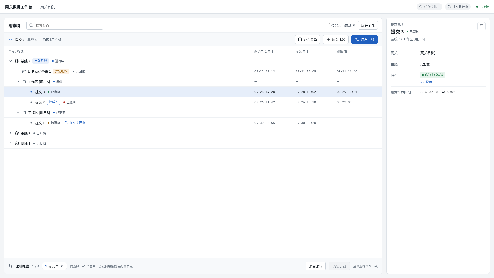
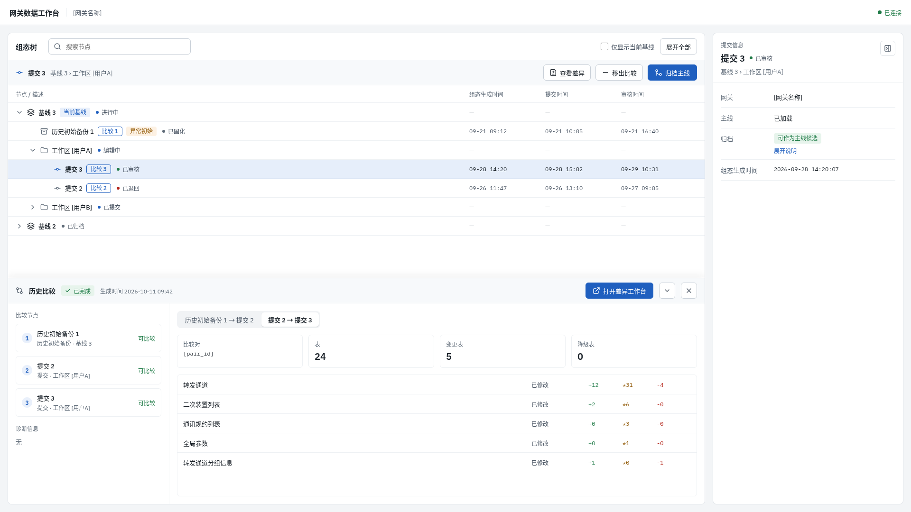
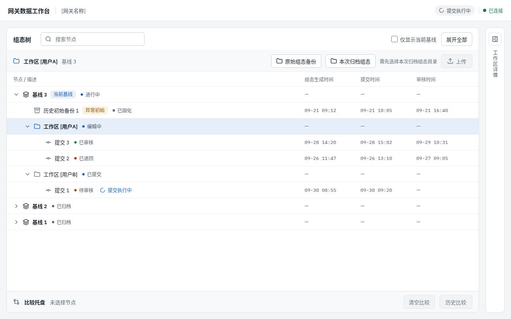

# 前端视觉与交互优化方向

- 状态：草案（第 2 节约束已于 2026-10-11 由 owner 确认；S1 草图已确认，其余“待草图”条目未定稿）
- 日期：2026-10-11
- 范围：新前端的视觉与交互约定；以 `legacy/frontend/` 为问题样本
- 不覆盖：数据面 surface / bundle 结构（见
  [frontend-surface-simplification.md](../backend-vnext/frontend-surface-simplification.md)）、
  业务流程与状态机（以 `docs/backend-vnext/refactoring/formal/` 当前 authority 为准）

本文只定方向与边界，不是完整设计规范。标注“待草图”的条目在草图验证后回填结论。
`legacy/frontend/` 只作行为与问题来源，不是改造目标；文中代码位置用于说明现状。

## 1. 目标与非目标

目标：

- 在用户可见内容不变的前提下，提升信息层级、可读性、操作可发现性和状态反馈。
- 给新前端建立一套可复用的视觉 token 与交互约定，避免再出现单文件硬编码样式。

非目标：

- 不新增或删减业务能力、业务操作、字段。
- 不改变流程语义（上传、提交、撤回、审核、归档、历史比较的前置条件与结果）。
- 不定义数据面结构，不要求后端为 UI 方便增加字段。

### 1.1 “内容不变”的边界

| 类别 | 处理 | 示例 |
| --- | --- | --- |
| 业务能力与操作集合 | 冻结 | 原始组态备份、本次归档组态、上传、提交、撤回、审核通过、退回、加入/移出/清空比较、查看差异、历史比较、归档主线 |
| 展示的业务字段 | 冻结 | 组态树四列；信息卡字段（提交人/审核人/归档确认人、各时间、时间异常原因、保留/确认理由）；表格行列内容 |
| 视图与分组 | 冻结 | 原始组态视图 / 本次组态视图；转发通道、二次装置列表、通讯规约列表等分组；全部 / 仅看差异 |
| 用户可见能力 | 冻结 | 以 surface 文档的 Legacy Capability Coverage 矩阵为准 |
| 布局、位置、组件形态 | 可改 | 按钮墙改为上下文操作；结果面板从信息卡移到抽屉 |
| 图标、颜色、字号、间距 | 可改 | 字母图标换成真实图标；token 化 |
| 交互方式 | 可改 | 搜索过滤、变更位置计数、原生弹窗换成应用内对话框 |
| 状态与反馈的呈现 | 可改 | 禁用原因、已选目录、进度时间线、骨架屏 |
| 界面文案语言与术语 | 可改，按 C6 | `Mainline`、`submit 排队`、`Strict Modal`、`Back To Workspace` 等中英混用 |
| 原始枚举 / 内部编码的默认可见性 | 可改，按 C6 | `reason_code`、`rule_id`、status 原始枚举，在 User 模式下是否改为可读描述 |

## 2. 需要先定的约束

以下约束已于 2026-10-11 由 owner 确认；C3 按 owner 意见调整。

| ID | 约束 | 约定 | 理由 | 状态 |
| --- | --- | --- | --- | --- |
| C1 | 最小支持视口宽度 | 1280px；1280–1440px 自动折叠次要面板 | legacy 正式工作台 `minmax(720px,1fr) 182px minmax(300px,380px)` 加 `overflow:hidden`，约 1300px 以下被裁切 | 已确认 |
| C2 | 移动端 / 平板 | 不支持，仅保证不报错 | 重浏览工作台，宽表格为主 | 已确认 |
| C3 | 键盘快捷键与可编程操作 | 首版不提供键盘快捷键；浏览类操作统一经 UI 命令层执行，为未来 agent 实时操作界面、供人浏览预留接口（见 5.1） | 当前无快捷键需求；agent 演示 / 引导浏览是已知的后续方向 | 已确认（调整） |
| C4 | 无障碍底线 | WCAG 2.1 AA 对比度；可见焦点；状态不只靠颜色表达 | legacy 无任何 `:focus` 样式；禁用态 `opacity:0.45` 对比度不足 | 已确认 |
| C5 | 主题 | 首版仅浅色；token 预留深色 | 工作台以表格为主，深色收益有限 | 已确认 |
| C6 | 界面语言与术语 | 界面统一中文；保留业务专名；原始编码默认移入 tooltip / Debug | legacy 中英混用，原始编码直接暴露给 User 模式 | 已确认 |
| C7 | 图标与组件依赖 | 引入单一图标库（如 lucide），本地打包；表格组件沿用 glide-data-grid | 需离线可用；表格已有虚拟化与大表经验 | 已确认 |

## 3. 视觉 token 原则

legacy 现状：`styles.css` 中有 403 处硬编码色值、0 个 CSS 变量；页面字体 IBM Plex Sans，
表格字体 Inter（`src/grid/theme.ts`）；页面冷灰蓝，表格边框暖棕 `rgba(58,47,38,…)`；
字号散布在 9–24px 的十余档，10–11px 出现四十余次。

原则：

1. **单一来源**。颜色、字号、间距、圆角、阴影全部定义为 token；表格主题从同一套 token 派生。
2. **语义色分组，不混用**：

   | 语义 | 承载方式 | 说明 |
   | --- | --- | --- |
   | 差异 insert / update / delete | 行或单元格底色 + `+ * -` 符号 | 绿 / 琥珀 / 红，三者色相分开 |
   | 风险等级 | 左侧色条或图标 + 文字等级 | 不占用行底色，避免与差异混淆 |
   | 流程 / 操作状态 | 圆点 + 文字 | 排队、执行中、完成、失败；不能只靠颜色 |
   | 连接状态 | 圆点 + 文字；断线时顶部横幅 | 取代仅有颜色的 `status-dot` |

   legacy 中 delete / update 行底色（`#fff1f2` / `#fff7ed`，见 `src/grid/adapter.ts`）与风险色同属红橙系，是要解决的问题。
3. **字号阶梯** 收敛为 12 / 13 / 14 / 16 / 20 五档；正文与表格 13px，正文不低于 12px。
4. **单一字体族**：页面与表格同一 sans 字体；哈希、ID、编码用等宽字体。
5. **按钮层级** 固定四种：主要（每个区域最多一个）、次要、幽灵、危险。

## 4. 页面问题与方向

状态说明：`方向明确` 表示可直接进入实现约定；`待草图` 表示需草图验证后定稿。

### 4.1 正式工作台（legacy `FormalWorkspacePage` / `FormalWorkspaceTree`）

| ID | 现状 | 方向 | 状态 |
| --- | --- | --- | --- |
| F1 | 三栏固定宽度，小屏裁切；操作栏靠 `padding-top: 88px` 对齐 | 组态树为主区域；详情面板 400px，可折叠；视口 ≤1440px 默认折叠为右侧窄栏，树的四列保持完整；连接状态与后台任务移到顶栏（S1） | 方向明确 |
| F2 | 9 个操作按钮平铺成一列，用字母作图标，不分主次 | 树上方的上下文工具栏按选中节点类型显示操作：工作区 → 原始组态备份 / 本次归档组态 / 上传；提交 → 查看差异 / 加入（或移出）比较 / 归档主线；历史初始备份 → 查看差异 / 加入（或移出）比较；基线 → 加入（或移出）比较；移出 / 清空 / 历史比较放在比较托盘；9 个操作全部保留（S1） | 方向明确 |
| F3 | 上传三步并列；选完目录后界面上不显示所选内容 | 上传步骤卡：① 原始备份 ② 本次归档 ③ 上传；每步显示目录名、文件数、校验结果 | 方向明确 |
| F4 | 9 个按钮中只有“归档主线”“加入比较”通过 title 给出原因，其余按钮禁用时无说明 | 所有禁用操作给出原因（tooltip 或说明文字） | 方向明确 |
| F5 | 比较靠三个按钮 + 树上“比较 N”标签 | 比较托盘固定在组态树底部（已选列表带序号、单项移除、清空、“历史比较”主按钮）；可加入比较的节点为基线、历史初始备份、提交（不论审核状态），工作区不可加入。布局已由 S1 确定，各状态待 S2 | 待草图 |
| F6 | 历史比较结果占用右侧信息卡，比较时看不到节点详情 | 比较结果在组态树下方的抽屉中展开（可收起、可关闭），右侧详情面板不被占用；树上“比较 N”与抽屉中的节点顺序一致；三节点时按相邻节点分为两个比较对（S1） | 方向明确 |
| F7 | 树行标签过多（类型、当前基线、异常、原始 status、比较序号、operations） | 类型用节点形状 / 图标表达；状态用圆点 + 中文；多个 operation 合并为一个进度指示 | 方向明确 |
| F8 | 树只有“仅显示当前基线”过滤；列头不可排序、不可调宽 | 增加节点搜索；列头可排序、可调宽 | 方向明确 |
| F9 | 信息卡 `Mainline` 显示“已加载”、`Archive` 显示长原因文本，信息密度低 | 状态字段用简短标签，长原因折叠展开 | 方向明确 |

### 4.2 差异浏览工作台（legacy `WorkbenchPage`）

| ID | 现状 | 方向 | 状态 |
| --- | --- | --- | --- |
| W1 | 顶栏操作同一样式（上传 / 提交 / 撤回 / 审核通过 / 退回） | 提交、审核通过为主要按钮；撤回、退回为危险按钮并二次确认；其余次要 | 方向明确 |
| W2 | 顶栏右侧拥挤：全部/仅看差异、视图按钮（每个带 2–3 个徽章）、User/Debug、返回工作台 | “返回”并入左侧面包屑；视图切换下移为第二行分段控件 | 待草图 |
| W3 | 四层导航（视图 → 分组树 → tab → 变更组），每层重复挂变更徽章 + 风险徽章 + 计数 | 拉开层级视觉差异；每个条目只保留一个合并后的徽章 | 待草图 |
| W4 | 变更导航只有 ← →，没有位置提示 | 显示“3 / 17”；表格旁加变更分布缩略条 | 方向明确 |
| W5 | 侧栏宽度不记忆；折叠后剩 8px，难以点中；无搜索 | 记忆宽度；折叠后保留图标栏；侧栏搜索 | 方向明确 |
| W6 | tab 横向溢出无提示 | 溢出时提供“更多”下拉 | 方向明确 |
| W7 | 风险提示条直接显示 `reason_code` / `rule_id` | User 模式显示可读描述，原始值放 tooltip / Debug（依赖 C6） | 方向明确 |
| W8 | Debug 条中的哈希被截断、不可复制 | 点击复制，完整值放 tooltip | 方向明确 |
| W9 | 修改行只能靠 tooltip 看到哪一列变了 | 修改行做单元格级高亮，可显示旧值 → 新值 | 待草图 |
| W10 | 三种模式（上传 / 审核 / 历史比较）的顶栏结构各写一份 | 统一顶栏骨架，只替换模式操作区 | 方向明确 |

### 4.3 归档主线审核弹窗（legacy `ArchiveMainlineReviewPanel`）

现有结构（预检状态、需逐一确认项、确认后影响、阻断说明）层次已较清楚，以套用 token 与按钮层级为主。

| ID | 现状 | 方向 | 状态 |
| --- | --- | --- | --- |
| A1 | 最终确认仍走 `window.confirm` | 改为弹窗内确认步骤，复用已有的“确认后的影响”摘要 | 方向明确 |
| A2 | 徽章与提示色自成一套 | 并入第 3 节语义色 | 方向明确 |

### 4.4 任务进度、加载与错误

| ID | 现状 | 方向 | 状态 |
| --- | --- | --- | --- |
| T1 | `StrictTaskModal` 只有阶段名和秒数，文案英文（Strict Modal / Locked / Elapsed / Close） | 阶段时间线，含每阶段耗时；失败阶段高亮并提供重试；锁定语义保持不变 | 方向明确 |
| T2 | Loading 页是一张写着 OPFS、manifest 的 hero 卡片 | 与目标布局一致的骨架屏 | 方向明确 |
| T3 | Error 页只有一个返回按钮 | 增加重试；显示错误码与可复制详情 | 方向明确 |

## 5. 跨页约定

| ID | 约定 | 依据 |
| --- | --- | --- |
| X1 | 不使用 `window.alert` / `confirm` / `prompt` | legacy 共 8 处：目录校验失败、归档确认、理由输入 |
| X2 | 校验失败用内联错误列表（可展开、可复制），保留当前选择 | 对应 FRONTEND_BACKGROUND 中“保留当前页面状态”的要求 |
| X3 | 需要填写理由的操作用带必填校验的对话框 | 替代 `window.prompt` |
| X4 | 破坏性操作二次确认，确认框显示影响摘要 | 撤回、退回、归档 |
| X5 | 所有可交互元素有可见焦点样式 | C4 |
| X6 | 用户布局偏好（侧栏宽度、折叠、显示模式）记在本地；读写失败时退回默认值 | 只作个人便利，不承载业务状态 |

### 5.1 UI 命令层（C3）

目的：未来允许 agent 实时操作界面，人在同一界面上观看浏览过程。首版只定边界，不实现外部驱动通道。

1. **同一路径**。浏览类操作定义为具名命令（稳定的命令名 + 参数），用户点击与外部驱动执行同一命令，
   不另写一套 agent 专用逻辑。首批覆盖：切换视图、选择节点、选择 tab、跳转到第 N 个变更、
   展开 / 折叠、全部 / 仅看差异、User / Debug、比较托盘的加入 / 移除。
2. **状态可寻址**。命令执行后的界面状态可序列化，并反映到 URL / 路由；外部驱动后的画面与人工操作到达的画面一致，可回放、可分享。
3. **只读优先**。上传、提交、撤回、审核通过、退回、归档主线等写操作不进入外部驱动通道。
   将来如需开放，须先修订 owning Contract / ADR，并保留人工确认。
4. **人可接管**。外部驱动时界面显示明确的“agent 操作中”指示；人工任意操作立即中止外部驱动。
5. **不预设传输**。首版不选型 WebSocket、postMessage 等通道，也不为其预建鉴权或审计机制；命令层只作为前端内部的架构边界存在。

## 6. 优先级

| 优先级 | 内容 | 条目 |
| --- | --- | --- |
| P1 | token、统一字体与字号、差异 / 风险语义色分离、按钮层级 | 第 3 节、W1、A2 |
| P2 | 去除原生弹窗；补禁用原因与已选目录展示；进度、加载、错误页 | X1–X4、F3、F4、A1、T1–T3 |
| P3 | 正式工作台布局与比较托盘；差异页顶栏与导航层级 | F1、F2、F5–F9、W2、W3、W5、W6、W10 |
| P4 | UI 命令层边界、变更缩略条、单元格级差异、复制与可读化细节 | 5.1、W4、W7–W9、X5 |

## 7. 草图清单

| 草图 | 验证条目 | 输出 |
| --- | --- | --- |
| S1 正式工作台整体布局 | F1、F2、F6 | 已确认（2026-10-11），见 7.1 |
| S2 上传步骤卡与比较托盘 | F3、F5 | 空、已选、校验失败、执行中四个状态 |
| S3 差异页顶栏与导航层级 | W2、W3、W4 | 三种模式下的顶栏线框 + 侧栏 / tab 层级 |
| S4 差异与风险的表格呈现 | 第 3 节语义色、W9 | insert / update / delete × 有无风险的组合样例 |

草图完成后在第 4 节将对应条目改为 `方向明确`，并记录取舍。

草图源文件与预览图存放在 `sketches/<草图>/`：HTML 为可直接用浏览器打开的静态快照（数据为示例，不是实现代码），PNG 为预览。
画布是工作底稿；每轮定稿后重新导出，与本文回填放在同一提交。

### 7.1 S1 正式工作台整体布局（已确认）

| 宽度 · 场景 | 源文件 |
| --- | --- |
| 1920 · 选中提交节点 | [main-1920.html](sketches/s1-formal-workspace/main-1920.html) |
| 1920 · 历史比较结果在底部抽屉 | [compare-1920.html](sketches/s1-formal-workspace/compare-1920.html) |
| 1280 · 选中工作区节点，详情面板折叠 | [narrow-1280.html](sketches/s1-formal-workspace/narrow-1280.html) |

owner 确认的取舍：

- 可加入比较的节点：基线、历史初始备份、提交（不论审核状态）；工作区不可加入。
- 三节点比较按相邻节点分为两个比较对；真实分组以后端 pair plan 为准。
- 节点状态文案（进行中、编辑中、已审核、已退回等）为占位，待与真实状态枚举对齐后再定。
- 时间、表数量、增删改计数为示例数据；分组名称取自 legacy。
- 桌面端按钮高 34px、树行高 40px，不考虑触屏（C2）。

## 8. 参考

- [frontend-surface-simplification.md](../backend-vnext/frontend-surface-simplification.md)：用户可见能力覆盖矩阵
- `legacy/frontend/FRONTEND_BACKGROUND.md`：legacy 前端业务背景与错误语义
- `legacy/frontend/src/App.tsx`、`src/styles.css`、`src/components/`、`src/grid/`：现状来源
